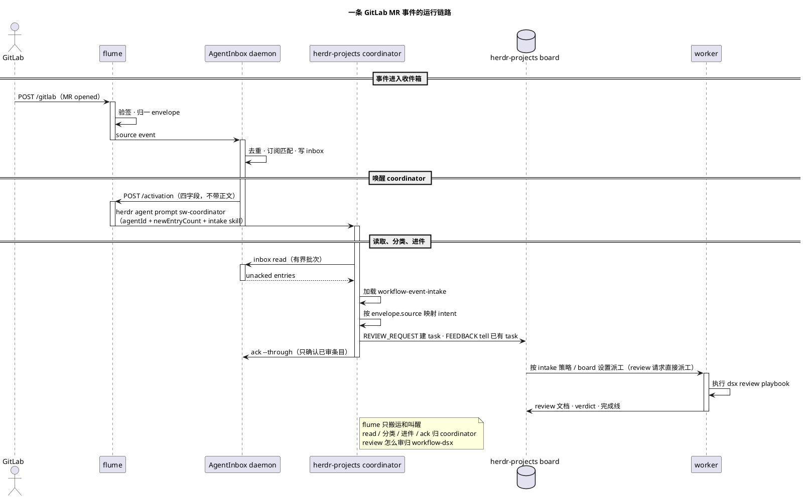

# flume

零状态事件转运层：把外部系统的事件**验签 → 归一成统一 envelope → 喂进 agent 收件箱 → 转发唤醒**。命名自渡槽：只负责把水从这头运到那头。

事件源、收件箱和唤醒器都是可替换的角色；GitLab、AgentInbox 和 herdr 只是当前的一组实现。flume 不定义这些产品，也不把它们的模型写进项目定义。

[使用指南 → docs/USAGE.md](docs/USAGE.md) · [架构 → docs/ARCHITECTURE.md](docs/ARCHITECTURE.md) · [Adapter 与扩展 → docs/ADAPTERS.md](docs/ADAPTERS.md) · [卸载 → docs/REMOVAL.md](docs/REMOVAL.md)

## 当前接线

```text
GitLab webhook → flume → AgentInbox → herdr-projects coordinator
                                      （sw-coordinator）
```

flume 只做四件事：**验签**、**归一**、**喂入收件箱**、**转发唤醒**。它不排队、
不重试、不持久化，也不决定是否开 turn。

当前只适配 GitLab。AgentInbox 由 flume 自动启动或 attach，不需要单独常驻；
唤醒直接执行 `herdr agent prompt sw-coordinator`，没有额外的唤醒门进程。
activation 只带唤醒信息，事件正文留在 AgentInbox。

## 安装

需要 Node.js `^22.23.4 || ^24.22.1 || >=26.12.1`，以及已安装的 herdr。
GitLab webhook token 放在系统钥匙串：

```text
service=flume-gitlab-webhook account=flume
```

然后在仓库根目录执行：

```bash
./run-flume.sh
```

脚本会自动安装依赖、构建、启动 flume，并启动或连接 AgentInbox。默认监听
`0.0.0.0:19420`，默认唤醒 `herdr-projects` 的 `sw-coordinator`。确认服务：

```bash
curl -sS http://127.0.0.1:19420/healthz
```

```json
{"ok":true}
```

到这里只启动了“搬运 + 叫醒”。事件到了 agent 之后怎么处理，由下面的流程和
intake 策略决定。

## 一条 GitLab 事件怎么走

以 `group/project!48` 被指定给你 review 为例：

1. GitLab 发出 `merge_request.opened`，`POST /gitlab`。
2. flume 验 `X-Gitlab-Token`，把 payload 归一成 `{source,event,subject,payload}`。
3. flume 写入 AgentInbox；AgentInbox 按 `native_id` 去重、匹配订阅、写 inbox。
4. AgentInbox 调 flume `/activation`，只带 `newEntryCount` 等唤醒字段。
5. flume 执行 `herdr agent prompt sw-coordinator`，prompt 里有 `agentId`、
   `newEntryCount` 和 `intakeSkill` 路径，但**没有事件正文**。
6. coordinator 读 AgentInbox，按 `envelope.source` 加载对应的
   `sources/<source>.md`（当前是 GitLab），把事件映射成 `REVIEW_REQUEST`。
7. coordinator 在 board 建 review task 并立即派工；brief 里写 MR、head sha、
   author，并指定走 `workflow-dsx` 的 `review` playbook。
8. review worker 建 worktree、跑 code-review-graph、写 review 文档；按授权决定
   是否发 MR 评论。不 approve、不 merge、不 close。
9. coordinator 只 `ack --through` 自己实际审过的 entry。

同一套链路处理其他 GitLab 事件：

- 你的 MR 出现他人 note，或被 approve / unapprove → `FEEDBACK`。按
  `source_branch` 的 `work/<n>-...` 找回 board task，把原始意见交给任务 agent；
  不自动 merge。
- 已关联 task 的 issue 有变动 → `ISSUE_UPDATE`。找回 task 并转交原始变动；
  新 issue 只入队，不自动派工。
- merged / closed → `LIFECYCLE`。更新或关闭对应 task。
- pipeline、重复投递、无关事件 → `NOISE`。审阅后 ack。

| intent | 触发 | coordinator 动作 |
| :--- | :--- | :--- |
| `REVIEW_REQUEST` | 你是 reviewer/assignee 的 open MR | 建 review task 并 `--delegate` |
| `FEEDBACK` | 你的 MR 出现他人 note / approve / unapprove | 找回已有 task，原文 `tell` |
| `ISSUE_UPDATE` | 已关联 issue 变动 | `tell` 已有 task；新 issue 入队 |
| `LIFECYCLE` | merged / closed | 更新或关闭 task |
| `NOISE` | pipeline、重复投递、无关事件 | 只 ack |

完整时序：



边界只有一句：**flume 决定不了“这是 review 还是反馈”，coordinator 按 intake skill
决定；review 的具体步骤不在 coordinator 里，交给 `workflow-dsx`。**

## 配置

### GitLab Webhook

日常只需要配置 GitLab。打开 `olap/miergo` 的项目 Webhook 页面：

<https://git.n.xiaomi.com/olap/miergo/-/hooks>

| 项 | 值 |
| :--- | :--- |
| URL | `http://10.224.202.16:19420/gitlab` |
| Secret token | 与钥匙串中的 `flume-gitlab-webhook` 一致 |
| Trigger | Merge request / Pipeline / Comments / Issues / Push |
| SSL verification | URL 是 HTTP，关闭 |

保存后点 **Test → Merge request events**；返回 `2xx` 即已接入。GitLab 必须能访问
flume 所在机器的内网地址，不能填 `127.0.0.1`。

### 环境变量

默认值全部写在 [`run-flume.sh`](run-flume.sh)。需要变更时直接改脚本，或在启动前
设置同名环境变量。用户通常不需要配置 AgentInbox。

| 变量 | 默认值 | 什么时候改 |
| :--- | :--- | :--- |
| `AGENTINBOX_SOURCE_ID` | `src_kdafkw75ry7k` | 换一个 AgentInbox source 时 |
| `FLUME_GITLAB_TOKEN` | 从 Keychain 读取 | 本地测试或换 token 时 |
| `FLUME_BIND` | `0.0.0.0` | 只允许本机访问时改 `127.0.0.1` |
| `FLUME_PORT` | `19420` | 端口冲突时；GitLab URL 要同步修改 |
| `FLUME_HERDR_WAKE_AGENT` | `sw-coordinator` | 换 herdr-projects 的 coordinator 时 |
| `FLUME_AGENTINBOX_AGENT_ID` | `herdr-main` | 换 coordinator 的 AgentInbox agent 时 |
| `FLUME_AGENTINBOX_INTAKE_SKILL` | 部署侧 skill；缺失时回退到 `templates/workflow-event-intake/SKILL.md` | agent 侧事件路由策略；flume 只传路径，不执行 |
| `HERDR_BIN_PATH` | `/Users/mi/.local/bin/herdr` | herdr 安装位置不同时 |
| `FLUME_HERDR_WAKE_TIMEOUT` | `10` | 唤醒命令经常超时时 |

`FLUME_HERDR_WAKE_URL` 只用于对接非 herdr 的外部 HTTP 唤醒器；当前部署不需要设置。
完整语义见 [`docs/USAGE.md` 的配置一节](docs/USAGE.md#配置)。

### intake skill

flume **不执行、不解析** intake skill，只把 `FLUME_AGENTINBOX_INTAKE_SKILL` 的路径
放进唤醒 prompt。策略本身属于 agent 侧，决定事件怎么分类、建不建 task、怎么 ack。

仓库自带模板：

```text
templates/workflow-event-intake/
  SKILL.md              # 通用 intake：read → classify → route → ack
  sources/gitlab.md     # GitLab 事件映射、glab 命令、work/<n> 约定
```

使用时复制到 agent workspace，改 `sources/gitlab.md` 里的 `ME`、`BOARD_REPO`、
`REVIEW_ROOT`、`BOARD_SHORT_KEY`，再让 `FLUME_AGENTINBOX_INTAKE_SKILL` 指向复制后的
`SKILL.md`。本仓库的 `run-flume.sh` 已经优先使用部署侧 skill，只有换 agent
workspace 或新增来源时才需要改。

GitLab 的默认映射：

| GitLab 事件 | intent | 动作 |
| :--- | :--- | :--- |
| 我是 reviewer/assignee 的 open MR | `REVIEW_REQUEST` | 建 review task 并立即派工；worktree 在 `review/worktrees/<group-project>/mr-<iid>` |
| 我的 MR 出现他人 note / approve / unapprove | `FEEDBACK` | 按 `work/<n>-...` 找回 task，原文交给 agent；不自动 merge |
| 已关联 task 的 issue 变动 | `ISSUE_UPDATE` | 把原始变动交给对应 task；新 issue 只入队 |
| merged / closed | `LIFECYCLE` | 更新或关闭 task |
| pipeline、重复投递、无关事件 | `NOISE` | 审阅后 ack |

review task 只读项目代码，可以按既有常设授权发布 review 评论；不 approve、不 merge、
不 close。原有两个 cron 巡检已被这条事件驱动链路取代。

## 扩展到其他事件源

新增来源要分两层，不要混：

| 层 | 位置 | 负责 |
| :--- | :--- | :--- |
| flume adapter | `src/adapters/<name>.ts` | webhook 验签、归一成 envelope |
| agent source policy | `templates/workflow-event-intake/sources/<name>.md` | envelope 到 intent、task 映射、命令 |

步骤：

1. 在 `src/adapters/<name>.ts` 实现 `NAME`、`SECRET_ENV`、`verify`、`normalize`。
2. 注册到 `src/adapters/index.ts`，并在 `run-flume.sh` 加 secret 的默认读取。
3. 在 `templates/workflow-event-intake/sources/<name>.md` 写事件到 intent 的映射、
   去重键、task 映射和命令。
4. 加 `verify` / `normalize` / `native_id` 的测试。

`core.ts`、intake 主流程和 `workflow-dsx` 都不需要改。当前支持：

| 系统 | Webhook 路径 | Secret |
| :--- | :--- | :--- |
| GitLab | `POST /gitlab` | `FLUME_GITLAB_TOKEN` |

完整示例见 [`docs/ADAPTERS.md`](docs/ADAPTERS.md)。

## 验证

1. `curl -sS http://127.0.0.1:19420/healthz` 返回 `{"ok":true}`。
2. GitLab webhook 的 **Test** 返回 `2xx`。
3. `tail -f logs/flume.launchd.log` 能看到 `accepted event=…` 和 `woke herdr agent=…`。
4. coordinator 空闲后，board 里出现由 inbox 聚合出的 task；多条事件可能按通知租约
   合并成一次 activation。coordinator 忙时 activation 排队，不会丢。
5. 处理完成后 `agentinbox inbox read --agent-id herdr-main --limit 10` 应该为空；
   没 ack 的条目说明 coordinator 还没审完。

本地验证：

```bash
npm test
npm run smoke
```

## 常驻运行

macOS 登录自启只需要一个 launchd job：`com.flume.gitlab`。plist 放在
`~/Library/LaunchAgents` 是 launchd 的用户级入口要求；仓库里的
[`deploy/com.flume.gitlab.plist`](deploy/com.flume.gitlab.plist) 只负责调用
`run-flume.sh`，配置仍只有脚本这一份。

```bash
mkdir -p logs
ln -sf "$PWD/deploy/com.flume.gitlab.plist" \
  "$HOME/Library/LaunchAgents/com.flume.gitlab.plist"
launchctl bootstrap "gui/$(id -u)" \
  "$HOME/Library/LaunchAgents/com.flume.gitlab.plist"
```

日志在 `logs/flume.launchd.log` 和 `logs/flume.launchd.err.log`。检查、重启和卸载见
[`docs/USAGE.md`](docs/USAGE.md) 与 [`docs/REMOVAL.md`](docs/REMOVAL.md)。

只有 flume 是 launchd 的常驻入口；AgentInbox daemon 由 flume ensure，coordinator
属于 herdr-projects 的运行态。coordinator 的 turn 是串行的：它正在处理别的请求时，
activation 会排队到当前 turn 结束，不会丢。排错见 [`docs/USAGE.md`](docs/USAGE.md)。
