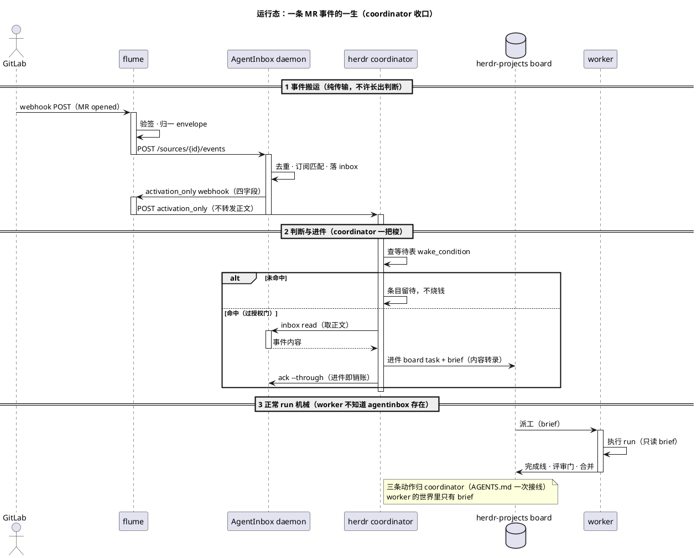

# flume

外部 webhook → AgentInbox 事件的零状态翻译层。命名自渡槽：只负责把水从这头运到那头。

架构合同：[`docs/ARCHITECTURE.md`](docs/ARCHITECTURE.md)。

## 是什么

```text
外部系统 ──webhook POST──▶ flume ──source event──▶ AgentInbox
                        验签·归一·喂入                    │
                                                          │ activation_only
                                                          ▼
herdr ◀──只转发四字段── flume /activation
```

flume 只做四件事：

1. **验签**：按 adapter 校验来源，GitLab 使用 `X-Gitlab-Token`
2. **归一**：折成 `native_id/event/occurred_at/source/subject/payload`
3. **喂入**：把事件交给 AgentInbox
4. **转发唤醒**：校验 activation_only 四字段并调用 herdr 唤醒门，不转发正文

## 快速开始

以下命令从仓库根目录开始。Node.js 版本与 `@holon-run/agentinbox` 保持一致：
`^22.23.4 || ^24.22.1 || >=26.12.1`。Node.js 23.x / 25.x 不在依赖声明的支持范围内。
本仓库验证机使用 Node.js 25.9.0，实际可以运行，但部署时应选择上方受支持的版本。

### 1. 安装并确认 CLI

```bash
npm install --silent
npm run build --silent
npm link --silent
export PATH="$PWD/node_modules/.bin:$PATH"
flume --help
```

**期望输出**

```text
Usage: flume start
```

仓库开发时使用上面的本地安装；`npm install -g flume` 供包发布后使用，安装后同样是
`flume start` 这一条入口。当前仓库尚未发布，直接用全局安装会拿到 npm 上的同名包。

### 2. 设置两个必填环境变量

本地自测先用固定值，不要求它们对应真实外部系统。

```bash
export AGENTINBOX_SOURCE_ID=src_local_smoke
export FLUME_GITLAB_TOKEN=local-smoke-token
test -n "$AGENTINBOX_SOURCE_ID" && test -n "$FLUME_GITLAB_TOKEN" && echo "env ready"
```

**期望输出**

```text
env ready
```

### 3. 启动 flume

```bash
flume start
```

**期望输出**（socket 路径随 `HOME` 变化）

首次运行，`~/.agentinbox` 下没有可用 daemon，flume 会启动它：

```text
flume: listening on 127.0.0.1:9420; agentinbox started at /Users/mi/.agentinbox/agentinbox.sock
```

已有 daemon 正在监听同一 socket，flume 会 attach 而不接管其生命周期：

```text
flume: listening on 127.0.0.1:9420; agentinbox attached at /Users/mi/.agentinbox/agentinbox.sock
```

保持这个终端运行，后续 curl 在另一个终端执行。

### 4. 本地自测：不依赖真实 GitLab 或 AgentInbox source

检查 HTTP 入口：

```bash
curl -sS http://127.0.0.1:9420/healthz
```

**期望输出**

```json
{"ok":true}
```

发送一个无需唤醒门的空 activation：

```bash
curl -sS -X POST http://127.0.0.1:9420/activation \
  -H 'Content-Type: application/json' \
  --data-binary '{"kind":"agentinbox.activation","newEntryCount":0,"latestEntryId":"entry-local-smoke","summary":"nothing new"}' \
  -w '\nstatus=%{http_code}\n'
```

**期望输出**

```text
{"accepted":0}
status=202
```

一次跑完 activation 的四个关键分支。这个命令会自己启动随机端口的 flume 与假唤醒门，不读取真实 AgentInbox：

```bash
npm run smoke
```

**期望输出**

```text
flume: woke herdr newEntryCount=2 latestEntryId=entry-local-smoke
[1] valid activation: status=202 accepted:1 body={"accepted":1}
[1] wake gate: POST /wake X-Flume-Activation-Mode=activation_only body={"kind":"agentinbox.activation","newEntryCount":2,"latestEntryId":"entry-local-smoke","summary":"2 new GitLab events"}
[2] entries payload: 400 {"error":"activation_only payload must not include \"entries\""}
[3] empty activation: status=202 accepted:0 body={"accepted":0}
[3] wake gate invocations: 1
flume: activation rejected: FLUME_HERDR_WAKE_URL is not set
[4] no wake URL: 503 {"error":"wake gate not configured"}
smoke: passed
```

### 5. 接真 GitLab webhook

先在另一个终端创建 AgentInbox 宿主、source、agent 与 subscription。flume 启动的 daemon 已在运行，直接执行即可。

```bash
HOST_ID=$(agentinbox host add local_event flume | node -pe 'JSON.parse(require("fs").readFileSync(0, "utf8")).hostId')
printf 'HOST_ID=%s\n' "$HOST_ID"
```

**期望输出**

```text
HOST_ID=hst_xjzrhzwxwbeg
```

AgentInbox 每次生成的 ID 不同，下面沿用这次输出的变量值即可。

```bash
SOURCE_ID=$(agentinbox source add "$HOST_ID" events gitlab | node -pe 'JSON.parse(require("fs").readFileSync(0, "utf8")).sourceId')
printf 'SOURCE_ID=%s\n' "$SOURCE_ID"
```

**期望输出**

```text
SOURCE_ID=src_qfzmjjznqbty
```

```bash
AGENT_ID=herdr-main
agentinbox agent register --agent-id "$AGENT_ID" \
  --webhook-url http://127.0.0.1:9420/activation \
  --webhook-activation-mode activation_only >/dev/null
agentinbox subscription add "$SOURCE_ID" --agent-id "$AGENT_ID" >/dev/null
printf 'agentinbox source ready for agent %s\n' "$AGENT_ID"
```

**期望输出**

```text
agentinbox source ready for agent herdr-main
```

停止第 3 步启动的 flume，再用真实 source 重启。以下命令在同一终端执行，`SOURCE_ID` 不需要手工抄写。

```bash
export AGENTINBOX_SOURCE_ID="$SOURCE_ID"
printf 'AGENTINBOX_SOURCE_ID=%s\n' "$AGENTINBOX_SOURCE_ID"
```

**期望输出**

```text
AGENTINBOX_SOURCE_ID=src_qfzmjjznqbty
```

```bash
flume start
```

**期望输出**（socket 路径随 `HOME` 变化）

首次运行，flume 启动 AgentInbox daemon：

```text
flume: listening on 127.0.0.1:9420; agentinbox started at /Users/mi/.agentinbox/agentinbox.sock
```

已有 daemon，flume 直接 attach：

```text
flume: listening on 127.0.0.1:9420; agentinbox attached at /Users/mi/.agentinbox/agentinbox.sock
```

准备一条最小的 GitLab MR payload：

```bash
cat > sample-mr.json <<'JSON'
{
  "object_kind": "merge_request",
  "project": {
    "path_with_namespace": "group/project"
  },
  "object_attributes": {
    "iid": 123,
    "action": "open",
    "state": "opened",
    "updated_at": "2026-10-26 09:00:00 UTC"
  }
}
JSON
echo "sample-mr.json written"
```

**期望输出**

```text
sample-mr.json written
```

像 GitLab 一样投递这条 webhook：

```bash
curl -sS -X POST http://127.0.0.1:9420/gitlab \
  -H 'Content-Type: application/json' \
  -H 'X-Gitlab-Token: local-smoke-token' \
  -H 'X-Gitlab-Event: Merge Request Hook' \
  -H 'X-Gitlab-Event-UUID: local-smoke-mr-1' \
  --data-binary @sample-mr.json \
  -w '\nstatus=%{http_code}\n'
```

**期望输出**

```text
{"accepted":1}
status=202
```

确认 AgentInbox 已收到：

```bash
for attempt in {1..50}; do
  INBOX=$(agentinbox inbox read --agent-id "$AGENT_ID")
  if printf '%s' "$INBOX" | grep -q '"entryId"'; then
    printf '%s\n' "$INBOX"
    break
  fi
  sleep 0.1
done
```

**期望输出**（entry ID、时间与 subscription ID 随运行变化）

```json
{
  "entries": [
    {
      "entryId": "ent_ecd4xf3bds6h",
      "kind": "item",
      "summary": "local_event:gitlab:merge_request.opened",
      "eventVariant": "merge_request.opened",
      "occurredAt": "2026-10-26T09:00:00+00:00",
      "ackedAt": null,
      "deliveryHandle": null,
      "metadata": {
        "subject": "group/project!123",
        "source": "gitlab",
        "matchReason": "filter shortcuts matched",
        "agentId": "herdr-main",
        "subscriptionId": "sub_xwkdav4zem8b"
      }
    }
  ],
  "agentId": "herdr-main"
}
```

真实 GitLab 的 Webhook 设置：

| 项 | 值 |
| :--- | :--- |
| URL | flume 所在机器的内网地址加 `/gitlab`，端口默认 `9420` |
| Secret token | 与 `FLUME_GITLAB_TOKEN` 完全一致 |
| Trigger | Merge request / Pipeline / Comment / Push |
| SSL verification | 内网 HTTP 可按部署环境关闭 |

本机 curl 使用 `127.0.0.1`；GitLab 在另一台机器时，Webhook URL 必须使用 GitLab 能访问到的 flume 内网地址。

### 6. 接 herdr 唤醒门

下面用本机地址确认配置形状；真实部署时只把这个值换成 herdr 唤醒门入口。这个 URL 是 flume 从 `/activation` 转发到的目标，不是 AgentInbox 的目标。

```bash
export FLUME_HERDR_WAKE_URL=http://127.0.0.1:18080/wake
printf 'FLUME_HERDR_WAKE_URL=%s\n' "$FLUME_HERDR_WAKE_URL"
```

**期望输出**

```text
FLUME_HERDR_WAKE_URL=http://127.0.0.1:18080/wake
```

停止当前 flume，再带上唤醒门配置重启：

```bash
flume start
```

**期望输出**

首次运行，flume 启动 AgentInbox daemon：

```text
flume: listening on 127.0.0.1:9420; agentinbox started at /Users/mi/.agentinbox/agentinbox.sock
```

已有 daemon，flume 直接 attach：

```text
flume: listening on 127.0.0.1:9420; agentinbox attached at /Users/mi/.agentinbox/agentinbox.sock
```

此后 AgentInbox 的 `activation_only` webhook 会 POST 到 flume `/activation`，flume 再向 `FLUME_HERDR_WAKE_URL` 发出：

```json
{
  "kind": "agentinbox.activation",
  "newEntryCount": 2,
  "latestEntryId": "entry-local-smoke",
  "summary": "2 new GitLab events"
}
```

请求头固定包含 `X-Flume-Activation-Mode: activation_only`。herdr 的等待表判据：

| 字段 | 判据 |
| :--- | :--- |
| `newEntryCount` | `> 0` 才叫醒；`0` 不调用唤醒门 |
| `latestEntryId` | 处理完 inbox 后执行 `ack --through`，值取 `latestEntryId` |
| `summary` | 只用于显示与日志，不参与授权 |

`entries` 或 `items` 正文一旦出现在 activation payload 中，flume 直接返回 400，不会转发。

## 排错表

| 现象 | 原因 | 处理 |
| :--- | :--- | :--- |
| 启动退出码 2，打印 `flume: missing env: ...` | `AGENTINBOX_SOURCE_ID` 或 `FLUME_GITLAB_TOKEN` 未设置 | `export` 两个必填变量后重启 |
| `POST /gitlab` 返回 `401 {"error":"invalid token"}` | `X-Gitlab-Token` 与 `FLUME_GITLAB_TOKEN` 不一致 | 对齐 GitLab Secret token 与环境变量 |
| `POST /gitlab` 返回 `502 {"error":"feed failed"}` | `AGENTINBOX_SOURCE_ID` 不存在，或 AgentInbox 拒绝事件 | 用 `agentinbox source show "$AGENTINBOX_SOURCE_ID"` 检查 source |
| `POST /activation` 返回 `503 {"error":"wake gate not configured"}` | 未设置 `FLUME_HERDR_WAKE_URL` | 设置后重启 flume |
| `POST /activation` 返回 `502 {"error":"wake gate failed"}` | 唤醒门不可达、超时或返回非 2xx | 检查 `FLUME_HERDR_WAKE_URL`、网络与唤醒门状态 |
| 请求返回 `413 {"error":"body too large"}` | webhook body 超过 8MB | 缩小 payload；flume 不接收超限 body |

## 进程模型

**用户只启动一个东西：`flume start`。** AgentInbox daemon 不用单独启动；flume 探 `~/.agentinbox/agentinbox.sock`，没有就自举，已在运行就 attach（ensure ≠ own）。

| 角色 | 形态 | 职责 |
| :--- | :--- | :--- |
| AgentInbox daemon | 常驻 | 去重、订阅分发、落 inbox、派发 activation |
| flume | 随 `flume start` 监听 | 收 webhook、验签、归一、喂入、转发 activation_only |
| herdr coordinator | 常驻判断位 | 查等待表、授权、`inbox read`、进件、`ack --through` |
| worker | 随 run | 只读 brief 干活，不知道 AgentInbox 存在 |

事件链无轮询：

```text
GitLab
  → flume：验签 · 归一 · 喂入
  → AgentInbox：去重 · 订阅匹配 · 落 inbox
  → flume /activation：校验并只转发四字段
  → herdr 唤醒门：查等待表 wake_condition
       命中 → read 正文 → 进件 → ack → 派工
       未命中 → 条目留待，不烧钱
```

命令执行者是 **coordinator**（read、进件、ack 三条动作归判断位）；flume 只搬运，daemon 只管货，worker 只干活。**inbox 只是入口，brief 才是记忆**：事件内容转录进 brief 后 inbox 即销账。

### 完整运行态序列图



## 配置

全部走环境变量，token 不进仓库、不进日志、不进响应体。缺必填项直接 exit 2。

| 变量 | 默认 | 说明 |
| :--- | :--- | :--- |
| `AGENTINBOX_SOURCE_ID` | 必填 | 目标 source |
| `FLUME_GITLAB_TOKEN` | 必填 | GitLab webhook secret token |
| `FLUME_BIND` | `127.0.0.1` | 给内网打时改 `0.0.0.0` |
| `FLUME_PORT` | `9420` | 监听端口 |
| `FLUME_HERDR_WAKE_URL` | 未配置 | herdr 唤醒门的绝对 HTTP(S) URL |
| `FLUME_HERDR_WAKE_TIMEOUT` | `5` | 唤醒门调用超时，单位秒 |

## 端点

| 方法 | 路径 | 结果 |
| :--- | :--- | :--- |
| `POST` | `/gitlab` | `202 {"accepted":1}`；400 非 JSON/非法 envelope；401 token 错；413 超 8MB；502 feed 失败 |
| `POST` | `/activation` | `202 {"accepted":1}` 已转发；`202 {"accepted":0}` 空激活；400 非法或带正文；502 唤醒门失败；503 未配置唤醒门 |
| `GET` | `/healthz` | `200 {"ok":true}` |

flume 不重试。事件 502 交给 GitLab 投递重试；相同投递的 `native_id` 不变，由 AgentInbox 去重。activation 502 交给 AgentInbox 的 webhook 投递机制重试。

## 唤醒链路

AgentInbox 写 inbox 后向 flume `/activation` 发 webhook。flume 只接受四个唤醒字段：

```json
{
  "kind": "agentinbox.activation",
  "newEntryCount": 2,
  "latestEntryId": "entry-local-smoke",
  "summary": "2 new GitLab events"
}
```

合法且 `newEntryCount > 0` 时，flume 向 `FLUME_HERDR_WAKE_URL` 发一次 `X-Flume-Activation-Mode: activation_only` 请求。`newEntryCount == 0` 返回 `202 {"accepted":0}` 且不调用唤醒门。

等待表合同：

```json
{
  "waitFor": {"kind": "agentinbox.activation", "newEntryCountAtLeast": 1},
  "newEntryCount": 2,
  "latestEntryId": "entry-local-smoke",
  "summary": "2 new GitLab events",
  "completeWhen": {"kind": "inbox.ack", "through": "entry-local-smoke"}
}
```

**唤醒 ≠ 授权。** flume 不决定是否开 turn；唤醒门命中后仍要过授权门，正文仍要回 `inbox read`。

## 事件归一

`gitlab` adapter 的映射：

| GitLab hook | event | subject |
| :--- | :--- | :--- |
| Merge Request Hook | `merge_request.opened`、`merge_request.merged`、`merge_request.closed` 等 | `group/project!123` |
| Pipeline Hook | `pipeline.success`、`pipeline.failed` 等 | `group/project#88` |
| Note Hook | `note.created` | 评论对象的 `!123` 或 `#iid` |
| Push Hook | `push` | `group/project` |
| 其他 | `object_kind` 加 `.received` | `group/project` |

`native_id` 优先 `X-Gitlab-Event-UUID`，其次 `X-Gitlab-Webhook-UUID`，都没有则对 raw body 做 SHA-256。同一投递重试得到同一 id。

## 新增 adapter

adapter 只有两件事：验签、折 envelope。core 不动，`src/adapters/` 加一个文件并在 `src/adapters/index.ts` 注册。

```typescript
export const NAME = "jira";
export const SECRET_ENV = "FLUME_JIRA_TOKEN";

export function verify(headers, body, secret): boolean {
  return true;
}

export function normalize(headers, body, document): Envelope {
  return new Envelope(/* 折成统一 envelope */);
}
```

`SECRET_ENV` 自动进入启动必填名单。adapter 不许排队、重试、落盘、过滤、唤醒或决定等待判据。

## 明确不做的事

- 不做第二套投递（队列、重试、死信）——AgentInbox 已有
- 不做事件存储或回放——durable stream 已有
- 不做业务过滤——subscription 已有
- 不做唤醒策略——AgentInbox 通知策略与 herdr 授权门已有
