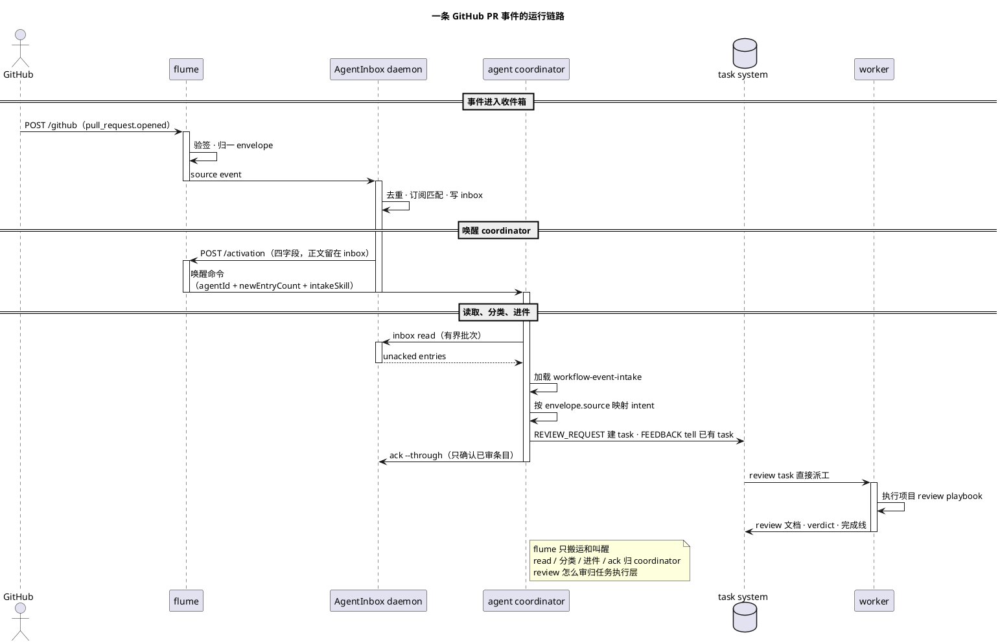

# flume

零状态事件转运层：把外部系统的事件**验签 → 归一成统一 envelope → 喂进收件箱 → 转发唤醒**。命名自渡槽：只负责把水从这头运到那头。

核心是 **flume + AgentInbox**：flume 负责接入和搬运，AgentInbox 负责去重、持久化、订阅、inbox 和 activation。事件源和唤醒器都可替换；文档以 GitHub 和 herdr 作为当前示例。

[使用指南 → docs/USAGE.md](docs/USAGE.md) · [架构 → docs/ARCHITECTURE.md](docs/ARCHITECTURE.md) · [Adapter 与扩展 → docs/ADAPTERS.md](docs/ADAPTERS.md) · [卸载 → docs/REMOVAL.md](docs/REMOVAL.md)

## 理念与目标

本地 agent 需要感知外部系统的事件。把轮询吸进 agent runtime，每接一个系统都会带上 webhook、重试、去重和回调路由。

flume 把接入、可靠性和业务判断拆开：

```text
事件源 → flume → AgentInbox → 唤醒器 / agent
```

- **flume 只负责接入**：验签、归一、写入收件箱、转发唤醒。
- **AgentInbox 负责可靠性**：去重、持久化、订阅匹配、inbox/ack、activation 租约。
- **agent 侧负责判断**：读 inbox、决定是否建 task、怎么执行。
- **事件源和唤醒器可替换**：GitHub 和 herdr 是当前示例；adapter 和唤醒目标按部署选择。

队列、重试、持久化和业务过滤由 AgentInbox 承担，是否开 turn 由 agent 侧判断。

## 快速安装

需要 Node.js `^22.23.4 || ^24.22.1 || >=26.12.1`，以及一个可用的唤醒目标。当前示例是 herdr。

依赖和构建由 [`run-flume.sh`](run-flume.sh) 在首次启动时自动完成。

先完成下面的“配置”：

1. 写入 GitHub webhook secret。
2. 配置 GitHub webhook。
3. 复制并配置 intake skill。
4. 复制 `.env.example` 为 `.env`，填入本机配置。

然后启动：

```bash
./run-flume.sh
```

脚本会自动安装依赖、构建、启动 flume，并启动或连接 AgentInbox。

<a id="event-flow"></a>
## 流程：一条 GitHub PR 事件

场景：`owner/repo#42` 由 `ada` 打开，你是 requested reviewer。GitHub 是事件源示例；换成其他 adapter 时，flume、AgentInbox 和 agent 侧的处理方式不变。

1. GitHub 发出 `pull_request.opened`，`POST /github`。
2. flume 用 `X-Hub-Signature-256` 验签，归一成 `{source:"github", event:"pull_request.opened", subject:"owner/repo#42"}`。
3. flume 写入 AgentInbox；AgentInbox 按 `X-GitHub-Delivery` 去重、匹配订阅、写 inbox。
4. AgentInbox 调 flume `/activation`，只带 `newEntryCount` 等唤醒字段。
5. flume 执行唤醒命令，prompt 带 intake skill 路径；PR 正文留在 AgentInbox，由 coordinator 读取。
6. coordinator 读 inbox，加载 `sources/github.md`，映射成 `REVIEW_REQUEST`。
7. coordinator 在任务系统建 review task；brief 里写 PR URL、head sha、author，并指定走项目自己的 `review` playbook。
8. review worker 建 worktree、按项目流程分析代码、写 review 文档；按授权决定是否发 review comment，approve / request changes / merge 由人类决定。
9. coordinator 只 ack 自己审过的 entry。

如果 `ada` 后来提交了 review：

- `pull_request_review.submitted`（`approved` / `changes_requested` / `commented`）→ `FEEDBACK`。
- `pull_request_review_comment.created` 或 PR 上的 `issue_comment.created` → `FEEDBACK`。
- coordinator 按 `headRefName` 找回对应 task；task 空闲时原文 `tell` 过去，merge 由人类决定。

完整时序：



边界：**flume 只做传输和叫醒；coordinator 按 intake skill 判断这是 review 还是反馈，具体步骤交给任务自己的执行 playbook。**

## 配置

默认值在 [`run-flume.sh`](run-flume.sh)。本机配置写入仓库根目录 `.env`，脚本启动时用 `source` 加载；同名 shell 变量会被 `.env` 覆盖。

```bash
cp .env.example .env
chmod 600 .env
$EDITOR .env
```

`.env` 已被 Git 忽略，权限必须为 `600`。模板 `.env.example` 只列变量；密钥优先放 Keychain。

| 变量 | 默认值 | 用途 |
| :--- | :--- | :--- |
| `FLUME_ADAPTERS` | `github` | 启用的事件源，逗号分隔：`github`、`gitlab` 或 `github,gitlab` |
| `AGENTINBOX_SOURCE_ID` | **必填** | AgentInbox 的 source id；事件写入该 source，订阅按它匹配 |
| `FLUME_GITHUB_SECRET` | 从 Keychain 读取 | GitHub webhook secret；非 macOS 或本地测试时可直接用环境变量 |
| `FLUME_GITLAB_TOKEN` | 未设置 | 仅在启用 `gitlab` adapter 时需要 |
| `FLUME_BIND` | `0.0.0.0` | 监听地址；只允许本机访问时改 `127.0.0.1` |
| `FLUME_PORT` | `19420` | 监听端口；修改后 webhook URL 要同步修改 |
| `FLUME_HERDR_WAKE_AGENT` | 未设置 | 唤醒器使用的 coordinator agent 名；workspace 名独立配置 |
| `FLUME_AGENTINBOX_AGENT_ID` | 未设置 | coordinator 在 AgentInbox 中的 agent id，用于读取和确认 inbox |
| `FLUME_AGENTINBOX_INTAKE_SKILL` | **必填** | 指向你自己配置过的 `SKILL.md`；flume 只传路径，由 agent 加载执行；缺失时拒绝启动 |
| `HERDR_BIN_PATH` | `herdr` | 当前 herdr 示例的唤醒器可执行文件路径 |
| `FLUME_HERDR_WAKE_TIMEOUT` | `10` | 唤醒命令超时，单位秒 |
| `FLUME_HERDR_WAKE_URL` | 未设置 | 外部 HTTP 唤醒器的 endpoint；herdr 示例走命令唤醒 |

AgentInbox 的 source 和订阅由部署配置；flume 侧集中设置 `FLUME_ADAPTERS`、webhook secret 和 `FLUME_AGENTINBOX_INTAKE_SKILL`。

### GitHub webhook secret

macOS 示例从系统钥匙串读取：

```text
service=flume-github-webhook account=flume
```

写入 secret（输入只用于 Keychain，随后从 shell 环境清除）：

```bash
printf 'GitHub webhook secret: '
read -rs FLUME_GITHUB_SECRET
echo
security add-generic-password -U \
  -a flume -s flume-github-webhook -w "$FLUME_GITHUB_SECRET"
unset FLUME_GITHUB_SECRET
```

不使用 macOS 时，启动前直接设置 `FLUME_GITHUB_SECRET` 即可。

### GitHub webhook

在仓库的 **Settings → Webhooks → Add webhook** 中配置：

| 项 | 值 |
| :--- | :--- |
| Payload URL | `http://<flume-host>:19420/github` |
| Content type | `application/json` |
| Secret | 与钥匙串中的 `flume-github-webhook` 一致 |
| SSL verification | URL 是 HTTP 时关闭 |
| Events | Pull requests、Pull request reviews、Pull request review comments、Issue comments、Issues；按需加 Pushes / Workflow runs |

保存后点 **Recent Deliveries → Redeliver**；返回 `2xx` 即已接入。Webhook URL 使用 GitHub 能访问到的 flume 主机地址。

flume 验签使用 `X-Hub-Signature-256`，并以 `X-GitHub-Delivery` 作为 `native_id`。同一投递重复 redeliver 会由 AgentInbox 去重。

### agent intake skill

intake skill 由 agent workspace 提供。复制模板并按你的任务系统配置，然后用 `FLUME_AGENTINBOX_INTAKE_SKILL` 指向复制后的 `SKILL.md`。

1. 复制模板到 agent workspace：

   ```bash
   cp -R templates/workflow-event-intake \
     /path/to/your-agent/.agents/skills/
   ```

2. 编辑 `sources/github.md`，填 `GITHUB_LOGIN`、`TASK_CLI`、`TASK_REPO`、`TASK_PREFIX`、`REVIEW_WORKSPACE`，并按你的任务系统调整命令。
3. 设置 `FLUME_AGENTINBOX_INTAKE_SKILL` 指向复制后的 `SKILL.md`。
4. 重启 flume，让新路径进入 activation prompt。

skill 的职责：

- 读 AgentInbox 未 ack 条目，最多 50 条。
- 按 `envelope.source` 加载 `sources/<source>.md`。
- 把事件映射成 `REVIEW_REQUEST` / `FEEDBACK` / `ISSUE_UPDATE` / `LIFECYCLE` / `NOISE`。
- review 请求建 task 并派工；反馈找回已有 task 并转交原文；issue 变动找回已关联 task；噪声只 ack。
- `ack --through` 最后一条实际审过的 entry。

GitHub 的参考映射（按你的配置修改 `sources/github.md`）：

| GitHub 事件 | intent | 动作 |
| :--- | :--- | :--- |
| 我是 requested reviewer/assignee 的 open PR | `REVIEW_REQUEST` | 建 review task 并立即派工 |
| 我的 PR 出现 review / review comment / issue comment | `FEEDBACK` | 找回 task，原文交给 agent；merge 由人类决定 |
| 我的 PR 被 approve / changes requested / dismiss | `FEEDBACK` | 把 review state 和 head sha 交给 task |
| 已关联 task 的 issue 变动 | `ISSUE_UPDATE` | 把原始变动交给对应 task；新 issue 只入队 |
| merged / closed | `LIFECYCLE` | 更新或关闭 task |
| push、workflow_run、重复投递 | `NOISE` | 审阅后 ack |

## 扩展适配

新增来源分两层：

| 层 | 位置 | 负责 |
| :--- | :--- | :--- |
| flume adapter | `src/adapters/<name>.ts` | webhook 验签、归一成 envelope |
| agent source policy | 你的 agent workspace 里的 `sources/<name>.md` | envelope 到 intent、task 映射、命令 |

步骤：

1. 在 `src/adapters/<name>.ts` 实现 `NAME`、`SECRET_ENV`、`verify`、`normalize`。
2. 注册到 `src/adapters/index.ts`，并把来源名加入 `FLUME_ADAPTERS`。
3. 在 `run-flume.sh` 里补这个来源的 secret 读取。
4. 在 agent workspace 的 intake skill 里增加 `sources/<name>.md`。
5. 加 `verify` / `normalize` / `native_id` 的测试。

扩展范围只涉及 adapter 和 source policy，`core.ts`、intake 主流程和任务执行层保持稳定。当前支持：

| 系统 | Webhook 路径 | Secret |
| :--- | :--- | :--- |
| GitHub（示例） | `POST /github` | `FLUME_GITHUB_SECRET` |
| GitLab | `POST /gitlab` | `FLUME_GITLAB_TOKEN` |

完整示例见 [`docs/ADAPTERS.md`](docs/ADAPTERS.md)。GitLab 作为可选 adapter 保留。

## 常驻运行

前台运行直接执行 `./run-flume.sh`；需要 macOS 登录自启时再配置用户级 LaunchAgent。

把仓库里的 plist 链接到 `~/Library/LaunchAgents` 即可，launchd 会从该目录加载用户级 job。

仓库里的 [`deploy/com.flume.plist`](deploy/com.flume.plist) 就是 flume 进程的 launchd 入口，label 固定为 `com.flume`。事件源不影响 job 名称；本机配置写入 `.env`。

加载：

```bash
mkdir -p logs
ln -sf "$PWD/deploy/com.flume.plist" \
  "$HOME/Library/LaunchAgents/com.flume.plist"
launchctl bootstrap "gui/$(id -u)" \
  "$HOME/Library/LaunchAgents/com.flume.plist"
```

日志在 `logs/flume.launchd.log` 和 `logs/flume.launchd.err.log`。重启和卸载见 [`docs/USAGE.md`](docs/USAGE.md) 与 [`docs/REMOVAL.md`](docs/REMOVAL.md)。

launchd 加载 flume 的 `com.flume` job；AgentInbox daemon 由 flume ensure，coordinator 由唤醒器运行。coordinator 的 turn 是串行的：它正在处理别的请求时，activation 会排队到当前 turn 结束，事件仍保留在 inbox。
