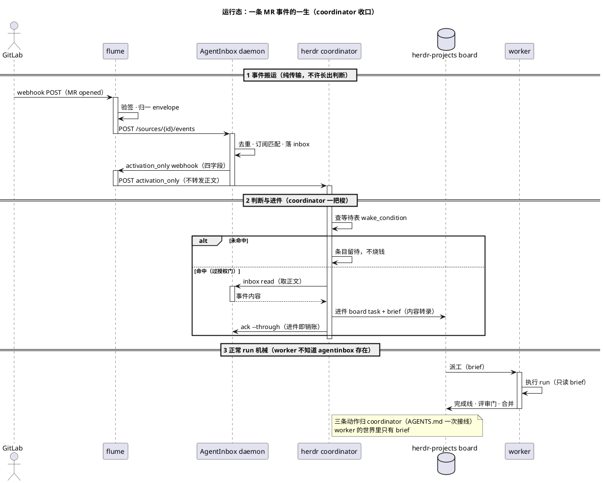

# flume

外部 webhook → AgentInbox 事件的零状态翻译层。命名自渡槽：只负责把水从这头运到那头。

架构合同：[`docs/ARCHITECTURE.md`](docs/ARCHITECTURE.md)。

> **状态**：阶段一核心通道与 activation_only 转发已实现；herdr 侧判据决策按阶段二推进。

## 是什么

```
外部系统 ──webhook POST──▶ flume ──source event──▶ AgentInbox
                        验签·归一·喂入                    │
                                                          │ activation_only
                                                          ▼
herdr ◀──只转发四字段── flume /activation
```

flume 做四件事，且只做四件事：

1. **验签**：按 adapter 校验来源（GitLab 用 `X-Gitlab-Token`）
2. **归一**：把各家 payload 折成统一 envelope（`native_id` / `event` / `occurred_at` / `source` / `subject` / `payload`）
3. **喂入**：把事件交给 AgentInbox 收件箱
4. **转发唤醒**：校验 activation_only 四字段并调用 herdr 唤醒门，不转发正文

## 红线

1. **flume 零状态**：不存任何东西。重试、去重、持久化是 AgentInbox 的活。
2. **唤醒 ≠ 授权**：activation 只叫醒不推正文，开不开 turn 由 herdr 唤醒门按等待表判据决定。
3. **协议抄拓扑不抄**：用 AgentInbox 的 host/source/subscription 模型，不照搬实现；等待语义留在 herdr 等待表。

## 前置依赖

| 依赖 | 说明 |
| :--- | :--- |
| Node.js 22.23.4+（24 LTS 推荐） | 唯一运行时。flume 与 AgentInbox 同生态 |
| `@holon-run/agentinbox` | flume 的 npm dependency，安装时自动带齐（CLI + daemon） |

网络可达性：外部系统的 webhook 要能 POST 到 flume 监听口（内网 GitLab 直接给内网 IP；跨网段走隧道/relay）。

## 使用流程

### 一次性：AgentInbox 侧建源

```bash
# 1. 建宿主（共享配置单元，一个就够）
agentinbox host add local_event flume            # → hst_...

# 2. 建 source（事件流，一个外部系统一个）
agentinbox source add <hst_id> events gitlab     # → src_...

# 3. 注册 agent 并挂唤醒 target（activation_only）
agentinbox agent register --agent-id <herdr-agent> \
  --webhook-url http://<flume>:9420/activation \
  --webhook-activation-mode activation_only

# 4. 订阅（source 共享，subscription 私有——别一个 PR 一个 source）
agentinbox subscription add <src_id> --agent-id <herdr-agent>
```

### 安装与启动：单一入口

```bash
npm install -g flume
flume start
```

`flume start` 做三件事：

1. 探 `~/.agentinbox/agentinbox.sock`——活着就 attach，不碰它的生命周期；没有才 spawn `agentinbox serve`，own 它（**ensure ≠ own**，daemon 是共享设施）
2. 开 webhook 门（`FLUME_BIND:FLUME_PORT`）与 `/activation` 转发口
3. 退出只收自己 spawn 的子进程

### 外部系统侧：配置 webhook（内网 GitLab 为例）

群组或项目 → Settings → Webhooks：

| 项 | 值 |
| :--- | :--- |
| URL | `http://<flume内网IP>:9420/gitlab` |
| Secret token | 与 `FLUME_GITLAB_TOKEN` 一致 |
| 触发事件 | Merge request / Pipeline / Comments / Push |
| SSL verification | 内网 HTTP 可关 |
| 冒烟 | 点 Push events 测试 → 期望 `202 {"accepted":1}` |

### 验证链路

```bash
# 1. flume 吃进去
curl -X POST http://127.0.0.1:9420/gitlab -H "X-Gitlab-Token: $TOKEN" -d @sample-mr.json

# 2. AgentInbox 看到
agentinbox inbox read --agent-id <herdr-agent>

# 3. 唤醒门收到 activation（只叫醒，不推正文）
```

判据：inbox 出现 entry + 唤醒门收到 `kind: agentinbox.activation`。两条都到，链路才算通。

### 唤醒链路：activation_only

AgentInbox 写 inbox 后向 flume `/activation` 发 webhook。flume 只接受四个唤醒字段：

```json
{
  "kind": "agentinbox.activation",
  "newEntryCount": 2,
  "latestEntryId": "entry-42",
  "summary": "2 new GitLab events"
}
```

带有 `entries` / `items` 正文的请求直接 400。合法且 `newEntryCount > 0` 时，flume 向
`FLUME_HERDR_WAKE_URL` 发一次 `X-Flume-Activation-Mode: activation_only` 请求；
`newEntryCount == 0` 返回 `202 {"accepted":0}` 且不调用唤醒门。

herdr 等待表按 `newEntryCount` 判断是否叫醒，以 `latestEntryId` 作为完成判据：
处理完 inbox 条目后执行 `ack --through <latestEntryId>`。`summary` 只用于显示，
不参与授权。

## 进程模型：谁执行什么

**用户只启动一个东西：`flume start`。** AgentInbox daemon 不用单独启动——flume 探 `~/.agentinbox/agentinbox.sock`，没有就 spawn 自举，已在跑就 attach（ensure ≠ own）。

| 角色 | 形态 | 职责 | 何时活 |
| :--- | :--- | :--- | :--- |
| AgentInbox daemon | 常驻（系统引擎） | 去重、订阅分发、落 inbox、派发唤醒 | 一直跑 |
| flume | 随 `flume start` 监听 | 收 webhook → 验签 → 归一 → 喂 daemon；转发 activation_only | 事件到达那一刻 |
| herdr coordinator | 常驻（判断位） | 收唤醒 → 查等待表判据 → `inbox read` 取正文 → **进件 board task** → `ack --through` | 被唤醒那一刻 |
| worker | 随 run（执行位） | 执行 brief、走完成线/评审门——**不知道 agentinbox 存在** | run 期间 |

消息流转是**事件驱动**，全链无轮询：

```
GitLab 推事件
  → flume（验签·归一·喂入）                       瞬时
  → daemon（去重→订阅匹配→落 inbox→唤醒）          常驻引擎
  → flume /activation（校验并只转发四字段）         瞬时
  → coordinator 唤醒门（查等待表 wake_condition）
       命中 → read 取正文 → 进件 board task → ack 销账
              → 派工 → worker 跑 run（只读 brief）
       未命中 → 条目留待，不烧钱
```

命令执行者是 **coordinator**（read/进件/ack 三条动作归判断位）；flume 只搬运，daemon 只管货，worker 只干活。**inbox 只是入口，brief 才是记忆**——事件内容转录进 brief 后 inbox 即销账，记忆已落进三样之一（任务系统）。

### 完整运行态序列图



## 配置

全部走环境变量，token 不进仓库、不进日志、不进响应体。缺必填项直接 exit 2。

| 变量 | 默认 | 说明 |
| :--- | :--- | :--- |
| `AGENTINBOX_SOURCE_ID` | 必填 | 目标 source |
| `FLUME_GITLAB_TOKEN` | 必填 | GitLab webhook secret token |
| `FLUME_BIND` | `127.0.0.1` | 给内网打时改 `0.0.0.0` |
| `FLUME_PORT` | `9420` | 监听端口 |
| `FLUME_HERDR_WAKE_URL` | 未配置 | herdr 唤醒门的绝对 HTTP(S) URL |
| `FLUME_HERDR_WAKE_TIMEOUT` | `5` | 唤醒门调用超时，单位秒 |

## 端点

| 方法 | 路径 | 结果 |
| :--- | :--- | :--- |
| `POST` | `/<adapter>`，如 `/gitlab` | `202 {"accepted":1}` · `400` 非 JSON/非法 envelope · `401` token 错 · `502` 没喂进去 · `413` 超 8MB |
| `POST` | `/activation` | `202 {"accepted":1}` 已转发 · `202 {"accepted":0}` 空激活 · `400` 非法/带正文 · `502` 唤醒门失败 · `503` 未配置唤醒门 |
| `GET` | `/healthz` | `200 {"ok":true}` |

**不重试**：事件 `502` 交给上游投递重试；同一投递重试时 `native_id` 不变，AgentInbox 自动 dedupe。activation `502` 交给 AgentInbox 的 webhook 投递机制重试。

feed 走 AgentInbox 的 unix socket HTTP API（`POST /sources/{id}/events`），CLI spawn 为后备——唯一接缝就在 feed 一个模块。

## 事件归一（gitlab adapter）

| GitLab hook | event | subject |
| :--- | :--- | :--- |
| Merge Request Hook | `merge_request.<action>`（open→opened、merge→merged…缺 action 用 state） | `group/project!123` |
| Pipeline Hook | `pipeline.<status>` | `group/project#88` |
| Note Hook | `note.created` | 评论对象的 `!123` 或 `#iid` |
| Push Hook | `push` | `group/project` |
| 其他 | `<object_kind>.received` | `group/project` |

`native_id` 优先 `X-Gitlab-Event-UUID`，其次 `X-Gitlab-Webhook-UUID`，都没有则对 raw body 做 sha256——同一投递重试得到同一 id。

## 新增 adapter

一个 adapter = 一个外部系统的翻译器。core 不动，`src/adapters/` 加一个文件。

### 1. 写 `src/adapters/<system>.ts`

必须导出四个符号：

```typescript
export const NAME = "jira";                    // 路由段 POST /jira，全局唯一
export const SECRET_ENV = "FLUME_JIRA_TOKEN";  // secret 走哪个环境变量

export function verify(headers, body, secret): boolean {
  // 验签。true 放行，false 回 401。token 永不进日志。
}

export function normalize(headers, body, document): Envelope {
  // document = JSON.parse(body)。折成 envelope。
}
```

`SECRET_ENV` 会被自动收进必填名单——adapter 一注册，启动就必须有它。

### 2. Envelope 约定

| 字段 | 要求 |
| :--- | :--- |
| `native_id` | 必须稳定：同一投递重试 → 同一 id（去重键） |
| `event` | `<对象>.<动作>`，订阅过滤按它匹配 |
| `occurred_at` | ISO8601，取事件自身时间戳 |
| `source` | 系统名（= `NAME`） |
| `subject` | 人可读对象定位，等待表判据用它对齐 |
| `payload` | 原始 payload，不裁剪 |

### 3. 注册

`src/adapters/index.ts` 的注册表加一项。路由 `POST /<NAME>` 自动生效。

### 4. 配置

secret 对齐 `SECRET_ENV`；webhook URL 指到 `http://<flume>:9420/<NAME>`；新系统单独 `agentinbox source add`。

### 5. 测试

1. normalize 纯函数断言（重点 `native_id` 稳定性、`event` 命名）
2. 端到端冒烟：mock feed，POST 假 webhook，断言 202 与喂入参数
3. 错误路径：401 / 400 / 502

### 纪律

adapter 只有两件事：**验签、折 envelope**。不许排队、重试、落盘、过滤、唤醒、判据判断——那是 AgentInbox 或 herdr 的活。

## 明确不做的事

- 不做第二套投递（队列/重试/死信）——AgentInbox 已有
- 不做事件存储/回放——durable stream 已有
- 不做业务过滤——subscription 已有
- 不做唤醒策略——AgentInbox 通知策略 + herdr 授权门已有
