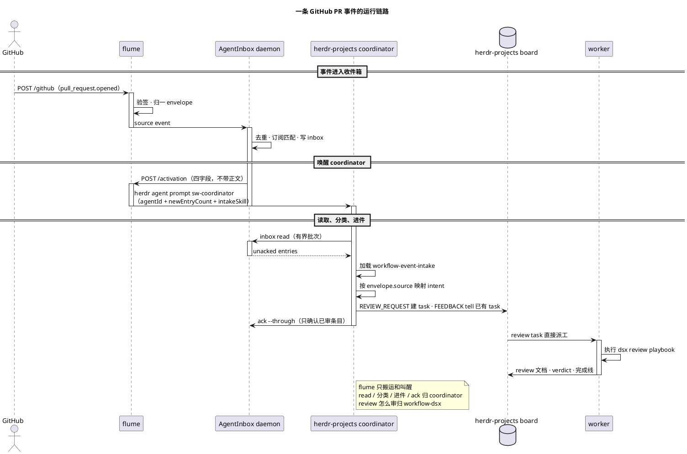

# flume

零状态事件转运层：把外部系统的事件**验签 → 归一成统一 envelope → 喂进 agent 收件箱 → 转发唤醒**。命名自渡槽：只负责把水从这头运到那头。

事件源、收件箱和唤醒器都是可替换的角色；GitHub、GitLab、AgentInbox 和 herdr 只是当前的一组实现。

[使用指南 → docs/USAGE.md](docs/USAGE.md) · [架构 → docs/ARCHITECTURE.md](docs/ARCHITECTURE.md) · [Adapter 与扩展 → docs/ADAPTERS.md](docs/ADAPTERS.md) · [卸载 → docs/REMOVAL.md](docs/REMOVAL.md)

## 当前接线

```text
GitHub webhook → flume → AgentInbox → herdr-projects coordinator
                                      （sw-coordinator）
```

flume 只做四件事：**验签**、**归一**、**喂入收件箱**、**转发唤醒**。它不排队、不重试、不持久化，也不决定是否开 turn。

AgentInbox 由 flume 自动启动或 attach，不需要单独常驻。唤醒直接执行 `herdr agent prompt sw-coordinator`，没有额外的唤醒门进程。activation 只带唤醒信息，事件正文留在 AgentInbox。

## 安装

需要 Node.js `^22.23.4 || ^24.22.1 || >=26.12.1`，以及已安装的 herdr。

依赖和构建由 [`run-flume.sh`](run-flume.sh) 在首次启动时自动完成。配置只有一处：脚本里的默认值，以及启动前设置的同名环境变量。这样前台启动、launchd 和 CI 走同一个入口，不依赖某个用户目录；没有 `~/.config/flume`，也没有第二份配置文件。

## 环境变量

默认值全部写在 [`run-flume.sh`](run-flume.sh)。需要变更时直接改脚本，或在启动前设置同名环境变量。

| 变量 | 默认值 | 用途 |
| :--- | :--- | :--- |
| `FLUME_ADAPTERS` | `github` | 启用的事件源，逗号分隔：`github`、`gitlab` 或 `github,gitlab` |
| `AGENTINBOX_SOURCE_ID` | `src_kdafkw75ry7k` | AgentInbox 的 source id；用来把事件写进同一个 source 并匹配订阅，通常不用改 |
| `FLUME_GITHUB_SECRET` | 从 Keychain 读取 | GitHub webhook secret；非 macOS 或本地测试时可直接用环境变量 |
| `FLUME_GITLAB_TOKEN` | 未设置 | 仅在启用 `gitlab` adapter 时需要 |
| `FLUME_BIND` | `0.0.0.0` | 监听地址；只允许本机访问时改 `127.0.0.1` |
| `FLUME_PORT` | `19420` | 监听端口；修改后 webhook URL 要同步修改 |
| `FLUME_HERDR_WAKE_AGENT` | `sw-coordinator` | herdr-projects 的 coordinator agent，不是 workspace 名 |
| `FLUME_AGENTINBOX_AGENT_ID` | `herdr-main` | coordinator 在 AgentInbox 中的 agent id |
| `FLUME_AGENTINBOX_INTAKE_SKILL` | **必填，无内置默认** | 指向你自己配置过的 `SKILL.md`；flume 只传路径，不执行 |
| `HERDR_BIN_PATH` | `/Users/mi/.local/bin/herdr` | herdr 安装位置不同时修改 |
| `FLUME_HERDR_WAKE_TIMEOUT` | `10` | `herdr agent prompt` 超时，单位秒 |
| `FLUME_HERDR_WAKE_URL` | 未设置 | 仅对接非 herdr 的外部 HTTP 唤醒器；当前部署不需要 |

AgentInbox 的 source 和订阅属于内部接线，正常运行不需要用户操作；通常只改 `FLUME_ADAPTERS`、webhook secret 和 `FLUME_AGENTINBOX_INTAKE_SKILL`。

### GitHub webhook secret

macOS 默认从系统钥匙串读取：

```text
service=flume-github-webhook account=flume
```

写入 secret（输入不会进入 shell 历史）：

```bash
printf 'GitHub webhook secret: '
read -rs FLUME_GITHUB_SECRET
echo
security add-generic-password -U \
  -a flume -s flume-github-webhook -w "$FLUME_GITHUB_SECRET"
unset FLUME_GITHUB_SECRET
```

不使用 macOS 时，启动前直接设置 `FLUME_GITHUB_SECRET` 即可。

## 接收事件：GitHub Webhook

在仓库的 **Settings → Webhooks → Add webhook** 中配置：

| 项 | 值 |
| :--- | :--- |
| Payload URL | `http://<flume-host>:19420/github` |
| Content type | `application/json` |
| Secret | 与钥匙串中的 `flume-github-webhook` 一致 |
| SSL verification | URL 是 HTTP 时关闭 |
| Events | Pull requests、Pull request reviews、Pull request review comments、Issue comments、Issues；按需加 Pushes / Workflow runs |

保存后点 **Recent Deliveries → Redeliver**；返回 `2xx` 即已接入。GitHub 必须能访问 flume 所在机器的内网地址，不能填 `127.0.0.1`。

flume 验签使用 `X-Hub-Signature-256`，并以 `X-GitHub-Delivery` 作为 `native_id`。同一投递重复 redeliver 会由 AgentInbox 去重。

GitLab 是可选 adapter：设置 `FLUME_ADAPTERS=gitlab` 和 `FLUME_GITLAB_TOKEN`，webhook 指向 `POST /gitlab`。详见 [`docs/ADAPTERS.md`](docs/ADAPTERS.md)。

## 处理事件：agent + skill

### 没有默认 skill

flume 不附带可直接生效的 intake skill，也不把 `templates/` 当成默认策略。模板只用于参考和复制；每个部署必须自己配置。

启动前必须满足：

```bash
FLUME_AGENTINBOX_INTAKE_SKILL=/path/to/your-agent/.agents/skills/workflow-event-intake/SKILL.md
```

该路径不存在时 `run-flume.sh` 会拒绝启动。

### 配置步骤

1. 复制模板到 agent workspace：

   ```bash
   cp -R templates/workflow-event-intake \
     /path/to/your-agent/.agents/skills/
   ```

2. 编辑 `sources/github.md`，填 `GITHUB_LOGIN`、`TASK_CLI`、`TASK_REPO`、`TASK_PREFIX`、`REVIEW_WORKSPACE`，并按你的任务系统调整命令。
3. 设置 `FLUME_AGENTINBOX_INTAKE_SKILL` 指向复制后的 `SKILL.md`。
4. 重启 flume，让新路径进入 activation prompt。

### skill 做什么

- 读 AgentInbox 未 ack 条目，最多 50 条。
- 按 `envelope.source` 加载 `sources/<source>.md`。
- 把事件映射成 `REVIEW_REQUEST` / `FEEDBACK` / `ISSUE_UPDATE` / `LIFECYCLE` / `NOISE`。
- review 请求建 task 并派工；反馈找回已有 task 并转交原文；issue 变动找回已关联 task；噪声只 ack。
- `ack --through` 最后一条实际审过的 entry。

intake 只决定“做不做、做哪个 task”。review 的具体步骤由 `workflow-dsx` 的 `review` playbook 执行；反馈继续由原 task 自己的 playbook 执行。

GitHub 的参考映射（按你的配置修改 `sources/github.md`）：

| GitHub 事件 | intent | 动作 |
| :--- | :--- | :--- |
| 我是 requested reviewer/assignee 的 open PR | `REVIEW_REQUEST` | 建 review task 并立即派工 |
| 我的 PR 出现 review / review comment / issue comment | `FEEDBACK` | 找回 task，原文交给 agent；不自动 merge |
| 我的 PR 被 approve / changes requested / dismiss | `FEEDBACK` | 把 review state 和 head sha 交给 task |
| 已关联 task 的 issue 变动 | `ISSUE_UPDATE` | 把原始变动交给对应 task；新 issue 只入队 |
| merged / closed | `LIFECYCLE` | 更新或关闭 task |
| push、workflow_run、重复投递 | `NOISE` | 审阅后 ack |

## 启动与验证

配置完成后启动：

```bash
FLUME_AGENTINBOX_INTAKE_SKILL=/path/to/your-agent/.agents/skills/workflow-event-intake/SKILL.md \
./run-flume.sh
```

默认启用 GitHub adapter，监听 `0.0.0.0:19420`，唤醒 `herdr-projects` 的 `sw-coordinator`。脚本会自动安装依赖、构建、启动 flume，并启动或连接 AgentInbox。

确认服务：

```bash
curl -sS http://127.0.0.1:19420/healthz
```

```json
{"ok":true}
```

然后按顺序验证：

1. GitHub webhook 的 **Redeliver** 返回 `2xx`。
2. `tail -f logs/flume.launchd.log` 能看到 `accepted event=…` 和 `woke herdr agent=…`。
3. coordinator 空闲后，board 里出现由 inbox 聚合出的 task。
4. 处理完成后 `agentinbox inbox read --agent-id herdr-main --limit 10` 应该为空；没 ack 的条目说明 coordinator 还没审完。

本地验证：

```bash
npm test
npm run smoke
```

## 一条 GitHub PR 事件怎么走

场景：`owner/repo#42` 由 `ada` 打开，你是 requested reviewer。

1. GitHub 发出 `pull_request.opened`，`POST /github`。
2. flume 用 `X-Hub-Signature-256` 验签，归一成 `{source:"github", event:"pull_request.opened", subject:"owner/repo#42"}`。
3. flume 写入 AgentInbox；AgentInbox 按 `X-GitHub-Delivery` 去重、匹配订阅、写 inbox。
4. AgentInbox 调 flume `/activation`，只带 `newEntryCount`。
5. flume 执行 `herdr agent prompt sw-coordinator`，prompt 带 `intakeSkill` 路径，但没有 PR 正文。
6. coordinator 读 inbox，加载 `sources/github.md`，映射成 `REVIEW_REQUEST`。
7. coordinator 在 board 建 review task 并 `--delegate`；brief 里写 PR URL、head sha、author，并指定走 `workflow-dsx` 的 `review` playbook。
8. review worker 建 worktree、跑 code-review-graph、写 review 文档；按授权决定是否发 review comment。不 approve、不 request changes、不 merge。
9. coordinator 只 ack 自己审过的 entry。

如果 `ada` 后来提交了 review：

- `pull_request_review.submitted`（`approved` / `changes_requested` / `commented`）→ `FEEDBACK`。
- `pull_request_review_comment.created` 或 PR 上的 `issue_comment.created` → `FEEDBACK`。
- coordinator 按 `headRefName` 的 `work/<n>-...` 找回 board task；task 空闲时原文 `tell` 过去，不自动 merge。

完整时序：



边界只有一句：**flume 决定不了“这是 review 还是反馈”，coordinator 按 intake skill 决定；review 的具体步骤不在 coordinator 里，交给 `workflow-dsx`。**

## 扩展到其他事件源

新增来源要分两层，不要混：

| 层 | 位置 | 负责 |
| :--- | :--- | :--- |
| flume adapter | `src/adapters/<name>.ts` | webhook 验签、归一成 envelope |
| agent source policy | 你的 agent workspace 里的 `sources/<name>.md` | envelope 到 intent、task 映射、命令 |

步骤：

1. 在 `src/adapters/<name>.ts` 实现 `NAME`、`SECRET_ENV`、`verify`、`normalize`。
2. 注册到 `src/adapters/index.ts`，并把来源名加入 `FLUME_ADAPTERS`。
3. 在 `run-flume.sh` 里补这个来源的 secret 读取。
4. 在 agent workspace 的 intake skill 里增加 `sources/<name>.md`。
5. 加 `verify` / `normalize` / `native_id` 的测试。

`core.ts`、intake 主流程和 `workflow-dsx` 都不需要改。当前支持：

| 系统 | Webhook 路径 | Secret |
| :--- | :--- | :--- |
| GitHub | `POST /github` | `FLUME_GITHUB_SECRET` |
| GitLab | `POST /gitlab` | `FLUME_GITLAB_TOKEN` |

完整示例见 [`docs/ADAPTERS.md`](docs/ADAPTERS.md)。当前 miergo 部署仍使用 GitLab adapter；GitHub 是默认示例。

## 常驻运行

`launchd` 不是必须的。前台运行只需要 `./run-flume.sh`；只有 macOS 登录自启才需要用户级 LaunchAgent。

`~/Library/LaunchAgents` 是 launchd 扫描用户级 job 的固定位置，所以那里必须有一个 plist 或指向仓库 plist 的软链。它不是第二份配置，配置仍在 `run-flume.sh` 和环境变量里。

仓库里的 [`deploy/com.flume.plist`](deploy/com.flume.plist) 就是 flume 进程的 launchd 入口，label 固定为 `com.flume`。事件源不影响 job 名称；接 GitHub 还是 GitLab，只改 `EnvironmentVariables` 里的 `FLUME_ADAPTERS` 和 `FLUME_AGENTINBOX_INTAKE_SKILL`。

加载：

```bash
mkdir -p logs
ln -sf "$PWD/deploy/com.flume.plist" \
  "$HOME/Library/LaunchAgents/com.flume.plist"
launchctl bootstrap "gui/$(id -u)" \
  "$HOME/Library/LaunchAgents/com.flume.plist"
```

日志在 `logs/flume.launchd.log` 和 `logs/flume.launchd.err.log`。重启和卸载见 [`docs/USAGE.md`](docs/USAGE.md) 与 [`docs/REMOVAL.md`](docs/REMOVAL.md)。

只有 flume 是 launchd 的常驻入口；AgentInbox daemon 由 flume ensure，coordinator 属于 herdr-projects 的运行态。coordinator 的 turn 是串行的：它正在处理别的请求时，activation 会排队到当前 turn 结束，不会丢。
