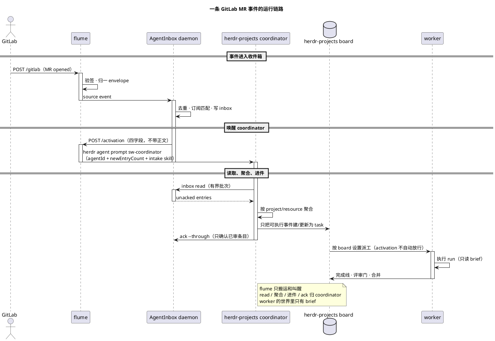

# flume

零状态事件转运层：把外部系统的事件**验签 → 归一成统一 envelope → 喂进 agent 收件箱 → 转发唤醒**。命名自渡槽：只负责把水从这头运到那头。

事件源、收件箱和唤醒器都是可替换的角色；GitLab、AgentInbox 和 herdr 只是当前的一组实现。flume 不定义这些产品，也不把它们的模型写进项目定义。

[使用指南 → docs/USAGE.md](docs/USAGE.md) · [架构 → docs/ARCHITECTURE.md](docs/ARCHITECTURE.md) · [Adapter 与扩展 → docs/ADAPTERS.md](docs/ADAPTERS.md) · [卸载 → docs/REMOVAL.md](docs/REMOVAL.md)

## 当前接线

```text
GitLab webhook → flume → AgentInbox → herdr-projects coordinator
                                      （sw-coordinator）
```

flume 只做四件事：**验签**、**归一**、**喂入收件箱**、**转发唤醒**。它不排队、
不重试、不持久化，也不决定是否开 turn。

当前只适配 GitLab。AgentInbox 由 flume 自动启动或 attach，不需要单独常驻；
唤醒直接执行 `herdr agent prompt sw-coordinator`，没有额外的唤醒门进程。
activation 会带上部署侧的 GitLab intake skill 路径，coordinator 按它路由事件。

## 快速启动

需要 Node.js `^22.23.4 || ^24.22.1 || >=26.12.1`，以及已安装的 herdr。
GitLab webhook token 放在系统钥匙串：

```text
service=flume-gitlab-webhook account=flume
```

然后在仓库根目录执行：

```bash
./run-flume.sh
```

脚本会自动安装依赖、构建、启动 flume，并启动或连接 AgentInbox。默认监听
`0.0.0.0:19420`，默认唤醒 `herdr-projects` 的 `sw-coordinator`。确认服务：

```bash
curl -sS http://127.0.0.1:19420/healthz
```

```json
{"ok":true}
```

## 配置 GitLab Webhook

日常只需要配置 GitLab。打开 `olap/miergo` 的项目 Webhook 页面：

<https://git.n.xiaomi.com/olap/miergo/-/hooks>

| 项 | 值 |
| :--- | :--- |
| URL | `http://10.224.202.16:19420/gitlab` |
| Secret token | 与钥匙串中的 `flume-gitlab-webhook` 一致 |
| Trigger | Merge request / Pipeline / Comments / Issues / Push |
| SSL verification | URL 是 HTTP，关闭 |

保存后点 **Test → Merge request events**；返回 `2xx` 即已接入。GitLab 必须能访问
flume 所在机器的内网地址，不能填 `127.0.0.1`。

## 事件如何落地

coordinator 读取 inbox 后，按 `system-weaver/.agents/skills/workflow-gitlab-event-intake/SKILL.md` 处理：

| 事件 | 动作 |
| :--- | :--- |
| 我被指定 reviewer/assignee 的 open MR | 在 `system-weaver` 建 review task 并立即派工；review 在 `review/worktrees/<group-project>/mr-<iid>` 里做 |
| 我自己的 MR 出现他人 note | 按 `work/<n>-...` 找回 board task，把原始 note 直接交给任务 agent 继续 |
| 已关联 task 的 issue 变动 | 把原始变动交给对应 task |
| pipeline 状态、重复投递、已合并/关闭事件 | 审阅后作为噪声 ack，不建 task |

review task 只读项目代码，可以按既有常设授权发布 review 评论；不 approve、不 merge、
不 close。原有两个 cron 巡检已被这条事件驱动链路取代。

## 验证

1. `curl -sS http://127.0.0.1:19420/healthz` 返回 `{"ok":true}`。
2. GitLab webhook 的 **Test** 返回 `2xx`。
3. `tail -f logs/flume.launchd.log` 能看到 `accepted event=…` 和 `woke herdr agent=…`。
4. coordinator 空闲后，board 里出现由 inbox 聚合出的 task；多条事件可能按通知租约
   合并成一次 activation。coordinator 忙时 activation 排队，不会丢。

## 默认配置

默认值全部写在 [`run-flume.sh`](run-flume.sh)。需要变更时直接改脚本，或在启动前
设置同名环境变量。用户通常不需要配置 AgentInbox。

| 变量 | 默认值 | 什么时候改 |
| :--- | :--- | :--- |
| `AGENTINBOX_SOURCE_ID` | `src_kdafkw75ry7k` | 换一个 AgentInbox source 时 |
| `FLUME_GITLAB_TOKEN` | 从 Keychain 读取 | 本地测试或换 token 时 |
| `FLUME_BIND` | `0.0.0.0` | 只允许本机访问时改 `127.0.0.1` |
| `FLUME_PORT` | `19420` | 端口冲突时；GitLab URL 要同步修改 |
| `FLUME_HERDR_WAKE_AGENT` | `sw-coordinator` | 换 herdr-projects 的 coordinator 时 |
| `FLUME_AGENTINBOX_AGENT_ID` | `herdr-main` | 换 coordinator 的 AgentInbox agent 时 |
| `FLUME_AGENTINBOX_INTAKE_SKILL` | `system-weaver/.agents/skills/workflow-gitlab-event-intake/SKILL.md` | 换事件路由策略时 |
| `HERDR_BIN_PATH` | `/Users/mi/.local/bin/herdr` | herdr 安装位置不同时 |
| `FLUME_HERDR_WAKE_TIMEOUT` | `10` | 唤醒命令经常超时时 |

`FLUME_HERDR_WAKE_URL` 只用于对接非 herdr 的外部 HTTP 唤醒器；当前部署不需要设置。
完整语义见 [`docs/USAGE.md` 的配置一节](docs/USAGE.md#配置)。

## 常驻运行

macOS 登录自启只需要一个 launchd job：`com.flume.gitlab`。plist 放在
`~/Library/LaunchAgents` 是 launchd 的用户级入口要求；仓库里的
[`deploy/com.flume.gitlab.plist`](deploy/com.flume.gitlab.plist) 只负责调用
`run-flume.sh`，配置仍只有脚本这一份。

```bash
mkdir -p logs
ln -sf "$PWD/deploy/com.flume.gitlab.plist" \
  "$HOME/Library/LaunchAgents/com.flume.gitlab.plist"
launchctl bootstrap "gui/$(id -u)" \
  "$HOME/Library/LaunchAgents/com.flume.gitlab.plist"
```

日志在 `logs/flume.launchd.log` 和 `logs/flume.launchd.err.log`。检查、重启和卸载见
[`docs/USAGE.md`](docs/USAGE.md) 与 [`docs/REMOVAL.md`](docs/REMOVAL.md)。

## Adapters

当前支持的 adapter 只有 GitLab：

| 系统 | Webhook 路径 | Secret |
| :--- | :--- | :--- |
| GitLab | `POST /gitlab` | `FLUME_GITLAB_TOKEN` |

新增 adapter 只需实现 `NAME`、`SECRET_ENV`、`verify`、`normalize` 四个导出，再加入
`src/adapters/index.ts` 的注册表。完整示例见 [`docs/ADAPTERS.md`](docs/ADAPTERS.md)。

## 运行链路



只有 flume 是 launchd 的常驻入口；AgentInbox daemon 由 flume ensure，coordinator
属于 herdr-projects 的运行态。coordinator 的 turn 是串行的：它正在处理别的请求时，
activation 会排队到当前 turn 结束，不会丢。排错见 [`docs/USAGE.md`](docs/USAGE.md)。
