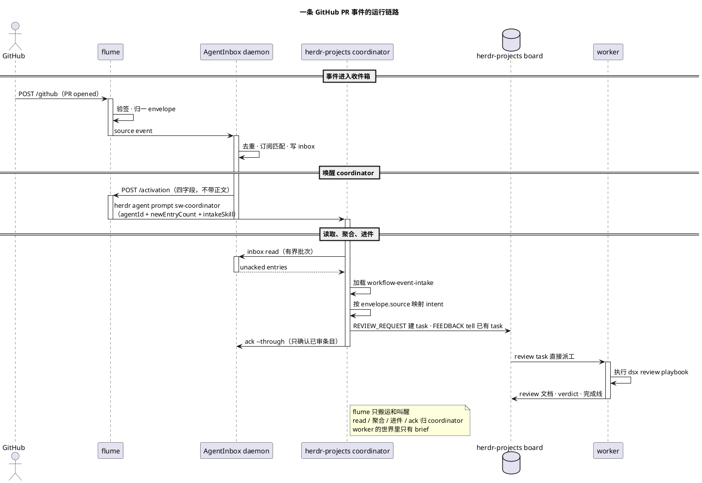

# flume 使用指南

flume 是零状态事件转运层：**验签 → 归一成统一 envelope → 喂进收件箱 → 转发唤醒**。事件源、收件箱和唤醒器都是可替换角色；当前接线是 GitHub、AgentInbox 和 herdr。

```text
GitHub webhook → flume → AgentInbox → flume /activation
                                      → herdr-projects coordinator
                                        （sw-coordinator）
```

用户只需要配置环境变量、GitHub webhook 和 agent 侧的 intake skill，然后启动 [`run-flume.sh`](../run-flume.sh)。AgentInbox 由 flume 自动启动或 attach，不需要单独安装、启动或配置；也没有独立的唤醒门进程。

## 1. 环境变量

所有默认值都在 [`run-flume.sh`](../run-flume.sh)。需要变更时直接改脚本，或在启动前设置同名环境变量。这样前台启动、launchd 和 CI 走同一个入口，不依赖某个用户目录；没有 `~/.config/flume`，也没有第二份配置文件。

| 变量 | 默认值 | 用途 |
| :--- | :--- | :--- |
| `FLUME_ADAPTERS` | `github` | 启用的事件源，逗号分隔：`github`、`gitlab` 或 `github,gitlab` |
| `AGENTINBOX_SOURCE_ID` | `src_kdafkw75ry7k` | AgentInbox 的 source id；用来把事件写进同一个 source 并匹配订阅，通常不用改 |
| `FLUME_GITHUB_SECRET` | 从 Keychain 读取 | GitHub webhook secret；非 macOS 或本地测试时可直接用环境变量 |
| `FLUME_GITLAB_TOKEN` | 未设置 | 仅在启用 `gitlab` adapter 时需要 |
| `FLUME_BIND` | `0.0.0.0` | 监听地址；只允许本机访问时改 `127.0.0.1` |
| `FLUME_PORT` | `19420` | 监听端口；修改后 GitHub webhook URL 要同步修改 |
| `FLUME_HERDR_WAKE_AGENT` | `sw-coordinator` | herdr-projects 的 coordinator agent，不是 workspace 名 |
| `FLUME_AGENTINBOX_AGENT_ID` | `herdr-main` | coordinator 在 AgentInbox 中的 agent id，用于读取和确认 inbox |
| `FLUME_AGENTINBOX_INTAKE_SKILL` | **必填，无内置默认** | 指向你自己配置过的 `SKILL.md`；flume 只传路径，不执行；缺失时拒绝启动 |
| `HERDR_BIN_PATH` | `/Users/mi/.local/bin/herdr` | herdr 可执行文件路径 |
| `FLUME_HERDR_WAKE_TIMEOUT` | `10` | `herdr agent prompt` 超时，单位秒 |
| `FLUME_HERDR_WAKE_URL` | 未设置 | 仅对接外部 HTTP 唤醒器；当前 herdr 接线不需要 |

AgentInbox 的 source 和订阅属于内部接线，正常运行不需要用户操作；通常只改 `FLUME_ADAPTERS`、webhook secret 和 `FLUME_AGENTINBOX_INTAKE_SKILL`。

例如临时换端口：

```bash
FLUME_PORT=19421 ./run-flume.sh
```

### GitHub webhook secret

macOS 默认从系统钥匙串读取：

```text
service=flume-github-webhook account=flume
```

写入 secret（输入不会进入 shell 历史）：

```bash
printf 'GitHub webhook secret: '
read -rs FLUME_GITHUB_SECRET
echo
security add-generic-password -U \
  -a flume -s flume-github-webhook -w "$FLUME_GITHUB_SECRET"
unset FLUME_GITHUB_SECRET
```

轮换时先更新钥匙串和 GitHub Webhook Secret，再重启 flume：

```bash
security delete-generic-password -a flume -s flume-github-webhook
```

不使用 macOS 时，启动前直接设置 `FLUME_GITHUB_SECRET` 即可。secret 不写入仓库、日志或 plist。

## 2. 接收事件：GitHub Webhook

打开仓库的 **Settings → Webhooks → Add webhook**：

1. Payload URL 填 `http://<flume-host>:19420/github`。
2. Content type 选 `application/json`。
3. Secret 填钥匙串里的同一个 secret。
4. 勾选 Pull requests、Pull request reviews、Pull request review comments、Issue comments、Issues；按需加 Pushes / Workflow runs。
5. URL 是明文 HTTP 时关闭 SSL verification。
6. 保存后点 **Recent Deliveries → Redeliver**，确认返回 `2xx`。

URL 必须是 GitHub 能访问到的地址，不能写 `127.0.0.1`。如果改了 `FLUME_PORT`，端口也要同步。

flume 验签使用 `X-Hub-Signature-256`，并以 `X-GitHub-Delivery` 作为 `native_id`。同一投递重复 redeliver 会由 AgentInbox 去重。

GitLab 是可选 adapter：设置 `FLUME_ADAPTERS=gitlab` 和 `FLUME_GITLAB_TOKEN`，webhook 指向 `POST /gitlab`。详见 [`ADAPTERS.md`](ADAPTERS.md)。

## 3. 处理事件：agent + skill

### 没有默认 skill

flume 不附带可直接生效的 intake skill，也不把 `templates/` 当成默认策略。模板只用于参考和复制；每个部署必须自己配置。

启动前必须满足：

```bash
FLUME_AGENTINBOX_INTAKE_SKILL=/path/to/your-agent/.agents/skills/workflow-event-intake/SKILL.md
```

该路径不存在时 `run-flume.sh` 会拒绝启动。

### 配置步骤

1. 复制模板到 agent workspace：

   ```bash
   cp -R templates/workflow-event-intake \
     /path/to/your-agent/.agents/skills/
   ```

2. 编辑 `sources/github.md`，填 `ME`、`BOARD_REPO`、`REVIEW_ROOT`、`BOARD_SHORT_KEY`，并按你的 board 调整命令。
3. 设置 `FLUME_AGENTINBOX_INTAKE_SKILL` 指向复制后的 `SKILL.md`。
4. 重启 flume，让新路径进入 activation prompt。

### skill 做什么

activation 只是叫醒，不带正文。coordinator 的固定动作：

1. `agentinbox inbox read` 读未 ack 条目，最多 50 条。
2. 按 `envelope.source` 分组，加载 `sources/<source>.md`。
3. 把事件映射成 intent：`REVIEW_REQUEST` / `FEEDBACK` / `ISSUE_UPDATE` / `LIFECYCLE` / `NOISE`。
4. 按 intent 路由：
   - `REVIEW_REQUEST` → 在 board 建 review task 并 `--delegate`
   - `FEEDBACK` → 找回已有 task，原始文本 `tell` 过去
   - `ISSUE_UPDATE` → 找回已关联 task；新 issue 只入队
   - `LIFECYCLE` → 更新或关闭 task
   - `NOISE` → 只 ack
5. `ack --through` 最后一条实际审过的 entry。

intake 只决定“做不做、做哪个 task”，不复制 review 步骤。真正的 review 由 `workflow-dsx` 的 `review` playbook 执行；反馈继续由原 task 自己的 playbook 执行。

模板只是参考，不是默认策略：

```text
templates/workflow-event-intake/
  SKILL.md              # 通用 intake：read → classify → route → ack
  sources/github.md     # GitHub 事件映射、gh 命令、work/<n> 约定
  sources/gitlab.md     # GitLab 事件映射、glab 命令
```

GitHub 的参考映射（按你的配置修改 `sources/github.md`）：

| GitHub 事件 | intent | 动作 |
| :--- | :--- | :--- |
| 我是 requested reviewer/assignee 的 open PR | `REVIEW_REQUEST` | 建 review task 并立即派工 |
| 我的 PR 出现 review / review comment / issue comment | `FEEDBACK` | 找回 task，原文交给 agent；不自动 merge |
| 我的 PR 被 approve / changes requested / dismiss | `FEEDBACK` | 把 review state 和 head sha 交给 task |
| 已关联 task 的 issue 变动 | `ISSUE_UPDATE` | 把原始变动交给对应 task；新 issue 只入队 |
| merged / closed | `LIFECYCLE` | 更新或关闭 task |
| push、workflow_run、重复投递 | `NOISE` | 审阅后 ack |

## 4. 启动与验证

### 前置条件

- Node.js `^22.23.4 || ^24.22.1 || >=26.12.1`
- 已安装 herdr，默认路径 `/Users/mi/.local/bin/herdr`
- 已按第 1 节配置 webhook secret
- 已按第 3 节配置 intake skill

### 一条命令启动

```bash
FLUME_AGENTINBOX_INTAKE_SKILL=/path/to/your-agent/.agents/skills/workflow-event-intake/SKILL.md \
./run-flume.sh
```

脚本会自解析仓库路径、从 Keychain 取 secret，并在缺少依赖或构建产物时自动执行 `npm install` / `npm run build`。

首次启动且本机没有 AgentInbox daemon 时：

```text
flume: listening on 0.0.0.0:19420; agentinbox started at /Users/<user>/.agentinbox/agentinbox.sock
```

已有 daemon 时：

```text
flume: listening on 0.0.0.0:19420; agentinbox attached at /Users/<user>/.agentinbox/agentinbox.sock
```

保持进程运行，另开终端检查：

```bash
curl -sS http://127.0.0.1:19420/healthz
```

```json
{"ok":true}
```

本地冒烟测试不会读取真实 AgentInbox：

```bash
npm run smoke
```

期望最后一行是 `smoke: passed`。

## 5. 模块调用序列



这里只有 flume 是 launchd 的常驻入口；AgentInbox daemon 由 flume ensure，coordinator 属于 herdr-projects 的运行态。没有额外的 wake gate 服务。coordinator 的 turn 是串行的：它正在处理别的请求时，activation 会排队到当前 turn 结束，不会丢。

## 6. AgentInbox 与唤醒语义

AgentInbox 写 inbox 后向 flume `/activation` 发送：

```json
{
  "kind": "agentinbox.activation",
  "newEntryCount": 2,
  "latestEntryId": "entry-local-smoke",
  "summary": "2 new GitHub events"
}
```

flume 只接受上述四个字段。`newEntryCount == 0` 返回 `202 {"accepted":0}`，不唤醒；大于 `0` 时执行：

```text
herdr agent prompt sw-coordinator "<固定唤醒文本>"
```

prompt 只包含配置中的 `agentId`、经过校验的 `newEntryCount`、intake skill 路径和固定指令，不包含事件正文。`latestEntryId` 和 `summary` 只用于日志。coordinator 收到后用 AgentInbox skill 读取 inbox，并读取 `FLUME_AGENTINBOX_INTAKE_SKILL` 指向的策略文件；事件内容仍必须回 AgentInbox 读取。

如果设置 `FLUME_HERDR_WAKE_AGENT=""` 并改用 `FLUME_HERDR_WAKE_URL`，flume 会向该 URL POST 四个字段并带 `X-Flume-Activation-Mode: activation_only`。这是非 herdr 唤醒器的兼容模式，不是当前部署路径。

## 7. 常驻运行

`launchd` 不是必须的。前台运行只需要 `./run-flume.sh`；只有 macOS 登录自启才需要用户级 LaunchAgent。

`~/Library/LaunchAgents` 是 launchd 扫描用户级 job 的固定位置，所以那里必须有一个 plist 或指向仓库 plist 的软链。它不是第二份配置，配置仍在 `run-flume.sh` 和环境变量里。

仓库里的 `deploy/com.flume.gitlab.plist` 是当前部署示例。接 GitHub 时复制一份并改 `Label`、`ProgramArguments`、`FLUME_ADAPTERS` 和 `FLUME_AGENTINBOX_INTAKE_SKILL`：

```bash
cp deploy/com.flume.gitlab.plist deploy/com.flume.github.plist
# Label=com.flume.github
# ProgramArguments=/absolute/path/to/flume/run-flume.sh
# FLUME_ADAPTERS=github
# FLUME_AGENTINBOX_INTAKE_SKILL=/path/to/your-agent/.agents/skills/workflow-event-intake/SKILL.md
mkdir -p logs
ln -sf "$PWD/deploy/com.flume.github.plist" \
  "$HOME/Library/LaunchAgents/com.flume.github.plist"
launchctl bootstrap "gui/$(id -u)" \
  "$HOME/Library/LaunchAgents/com.flume.github.plist"
```

查看状态和日志：

```bash
launchctl print "gui/$(id -u)/com.flume.github" | grep -E 'state =|pid ='
curl -fsS http://127.0.0.1:19420/healthz
tail -f logs/flume.launchd.log
tail -f logs/flume.launchd.err.log
```

升级后重启：

```bash
git pull
launchctl kickstart -k "gui/$(id -u)/com.flume.github"
```

停止并移除自启：

```bash
launchctl bootout "gui/$(id -u)/com.flume.github" 2>/dev/null || true
unlink "$HOME/Library/LaunchAgents/com.flume.github.plist"
```

`~/.agentinbox` 可能被其他 agent 共用；确认不再需要后再删除。完整撤除见 [`REMOVAL.md`](REMOVAL.md)。

## 8. Adapters

当前支持 GitHub 和 GitLab：

| 系统 | 路由 | Secret 环境变量 | 事件 |
| :--- | :--- | :--- | :--- |
| GitHub | `POST /github` | `FLUME_GITHUB_SECRET` | Pull request、Review、Review comment、Issue、Issue comment、Push、Workflow run |
| GitLab | `POST /gitlab` | `FLUME_GITLAB_TOKEN` | Merge request、Pipeline、Note、Push、Issue；其他事件归一为 `<object_kind>.received` |

新增 adapter 的完整示例见 [`ADAPTERS.md`](ADAPTERS.md)。快速步骤：

1. 在 `src/adapters/<name>.ts` 导出 `NAME`、`SECRET_ENV`、`verify`、`normalize`。
2. 在 `src/adapters/index.ts` 的 `ADAPTERS` 注册。
3. 在 `run-flume.sh` 注入对应的 secret。
4. 在 agent workspace 的 intake skill 里增加 `sources/<name>.md`。
5. 补 `verify`、`normalize`、`native_id` 稳定性测试。
6. 向 `POST /<NAME>` 投递样例，确认 `202 {"accepted":1}`。

adapter 只验签和折 envelope，不排队、不重试、不落盘、不做订阅过滤、不决定唤醒。

## 9. 端点

| 方法 | 路径 | 结果 |
| :--- | :--- | :--- |
| `POST` | `/github` | `202 {"accepted":1}`；401 签名错；400 非法 envelope；413 超过 8 MiB；502 喂入失败 |
| `POST` | `/gitlab` | 同上；仅在启用 `gitlab` adapter 时可用 |
| `POST` | `/activation` | `202 {"accepted":1}` 已唤醒；`202 {"accepted":0}` 空激活；400 带正文或字段非法；502 唤醒失败；503 未配置唤醒目标 |
| `GET` | `/healthz` | `200 {"ok":true}` |

flume 不重试：事件失败交给事件源重投，activation 失败交给 AgentInbox 重投。

## 10. 排错

| 现象 | 检查 |
| :--- | :--- |
| 启动提示 Keychain 读取失败 | 确认 `service=flume-github-webhook account=flume` 存在且非空；或直接设置 `FLUME_GITHUB_SECRET` |
| 启动提示 intake skill 不存在 | 检查 `FLUME_AGENTINBOX_INTAKE_SKILL` 是否是复制后的 `SKILL.md` 绝对路径 |
| `healthz` 不通 | 看 `logs/flume.launchd.err.log`；确认 `FLUME_PORT` 和进程是否启动 |
| GitHub 显示 `Connection refused` | 确认 `FLUME_BIND=0.0.0.0`、端口一致、主机防火墙和路由可达 |
| GitHub Delivery 超时 | GitHub 到 flume 主机没有可达路由；不要用 `127.0.0.1` 作为 Webhook URL |
| `401 {"error":"invalid token"}` | GitHub Webhook Secret 与 Keychain 中的值不一致 |
| `502 {"error":"feed failed"}` | `AGENTINBOX_SOURCE_ID` 不存在或 AgentInbox 拒收 |
| `502 {"error":"wake gate failed"}` | `herdr agent prompt` 失败；检查 agent 名、`HERDR_BIN_PATH` 和超时 |
| 返回 `202` 但 inbox 为空 | AgentInbox source 没有订阅到目标 agent |
| inbox 有条目但 herdr 没醒 | 检查 `FLUME_HERDR_WAKE_AGENT`、herdr 可执行文件和 `/activation` 日志 |
| 请求返回 `413 {"error":"body too large"}` | webhook body 超过 8 MiB |

验证时优先使用 GitHub 的 Redeliver 或真实 PR 事件，不要只在本机 curl `/healthz`。
