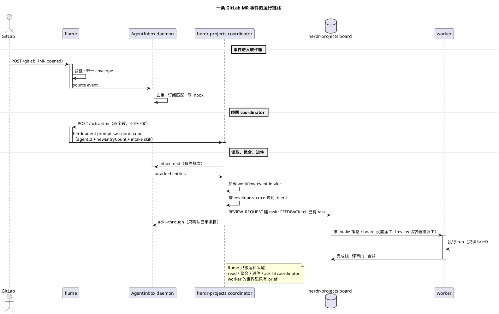

# flume 使用指南

flume 是零状态事件转运层：**验签 → 归一成统一 envelope → 喂进收件箱 → 转发唤醒**。
事件源、收件箱和唤醒器都是可替换角色；当前接线是 GitLab、AgentInbox 和 herdr。

```text
GitLab webhook → flume → AgentInbox → flume /activation
                                      → herdr-projects coordinator
                                        （sw-coordinator）
```

用户只需要启动 `./run-flume.sh` 和配置 GitLab webhook。AgentInbox 由 flume 自动
启动或 attach，不需要单独安装、启动或配置；也没有独立的唤醒门进程。

## 启动

### 前置条件

- Node.js `^22.23.4 || ^24.22.1 || >=26.12.1`
- 已安装 herdr，默认路径 `/Users/mi/.local/bin/herdr`
- GitLab webhook token 已写入系统钥匙串

首次写入 token（输入不会进入 shell 历史）：

```bash
printf 'GitLab webhook token: '
read -rs FLUME_GITLAB_TOKEN
echo
security add-generic-password -U \
  -a flume -s flume-gitlab-webhook -w "$FLUME_GITLAB_TOKEN"
unset FLUME_GITLAB_TOKEN
```

### 一条命令启动

```bash
./run-flume.sh
```

脚本会自解析仓库路径、从 Keychain 取 token，并在缺少依赖或构建产物时自动执行
`npm install` / `npm run build`。默认配置见[配置](#配置)。

首次启动且本机没有 AgentInbox daemon 时：

```text
flume: listening on 0.0.0.0:19420; agentinbox started at /Users/<user>/.agentinbox/agentinbox.sock
```

已有 daemon 时：

```text
flume: listening on 0.0.0.0:19420; agentinbox attached at /Users/<user>/.agentinbox/agentinbox.sock
```

保持进程运行，另开终端检查：

```bash
curl -sS http://127.0.0.1:19420/healthz
```

```json
{"ok":true}
```

本地冒烟测试不会读取真实 AgentInbox：

```bash
npm run smoke
```

期望最后一行是 `smoke: passed`。

## 配置 GitLab Webhook

打开 `olap/miergo` 的项目 Webhook 页面：

<https://git.n.xiaomi.com/olap/miergo/-/hooks>

1. 点击 **Add new webhook**。
2. URL 填 `http://10.224.202.16:19420/gitlab`。
3. Secret token 填钥匙串里的同一个 token。
4. 勾选 Merge request、Pipeline、Comments、Issues、Push events。
5. 关闭 SSL verification；当前 URL 是明文 HTTP。
6. 保存后点 **Test → Merge request events**，确认返回 `2xx`。

URL 必须是 GitLab 能访问到的内网地址，不能写 `127.0.0.1`。如果 flume 不在
`10.224.202.16`，把主机部分换成实际地址；如果改了 `FLUME_PORT`，端口也要同步。

也可以用 `glab` 创建项目级 hook：

```bash
glab api --hostname git.n.xiaomi.com --method POST \
  projects/262378/hooks \
  --field url=http://10.224.202.16:19420/gitlab \
  --field token="$FLUME_GITLAB_TOKEN" \
  --field merge_requests_events=true \
  --field pipeline_events=true \
  --field note_events=true \
  --field issues_events=true \
  --field push_events=true \
  --field enable_ssl_verification=false
```

这里需要当前 token 通过环境变量提供；日常 UI 配置不需要这一步。

## 配置

所有默认值都在 [`run-flume.sh`](../run-flume.sh)。需要变更时直接改脚本，或在启动前
设置同名环境变量。AgentInbox 的 source 和订阅属于内部接线，正常运行不需要用户操作。

| 变量 | 默认值 | 用途 |
| :--- | :--- | :--- |
| `AGENTINBOX_SOURCE_ID` | `src_kdafkw75ry7k` | AgentInbox 收件箱的 source；只在换 source 时修改 |
| `FLUME_GITLAB_TOKEN` | 从 Keychain 读取 | GitLab webhook secret；本地测试时可直接用环境变量覆盖 |
| `FLUME_BIND` | `0.0.0.0` | 内网 GitLab 可访问；只允许本机时改 `127.0.0.1` |
| `FLUME_PORT` | `19420` | 监听端口；修改后同步 GitLab webhook URL |
| `FLUME_HERDR_WAKE_AGENT` | `sw-coordinator` | `herdr-projects` 的 coordinator agent，不是 workspace 名 |
| `FLUME_AGENTINBOX_AGENT_ID` | `herdr-main` | coordinator 在 AgentInbox 中的 agent id，用于读取和确认 inbox |
| `FLUME_AGENTINBOX_INTAKE_SKILL` | 部署侧 skill；缺失时回退到 `templates/workflow-event-intake/SKILL.md` | agent 侧事件路由策略；flume 只传路径，不执行 |
| `HERDR_BIN_PATH` | `/Users/mi/.local/bin/herdr` | herdr 可执行文件路径 |
| `FLUME_HERDR_WAKE_TIMEOUT` | `10` | `herdr agent prompt` 超时，单位秒 |
| `FLUME_HERDR_WAKE_URL` | 未设置 | 仅对接外部 HTTP 唤醒器；当前 herdr 接线不需要 |

例如临时换端口：

```bash
FLUME_PORT=19421 ./run-flume.sh
```

钥匙串是 token 的人工维护源：

```text
service=flume-gitlab-webhook account=flume
```

轮换时先更新钥匙串和 GitLab Secret token，再重启 flume，最后删除旧凭据：

```bash
security delete-generic-password -a flume -s flume-gitlab-webhook
```

token 不写入仓库、日志或 plist。

## 常驻运行

macOS 登录自启只需要一个 launchd job：`com.flume.gitlab`。它只调用
`run-flume.sh`；配置仍只有脚本这一份，AgentInbox 不单独建 job。

```bash
mkdir -p logs
ln -sf "$PWD/deploy/com.flume.gitlab.plist" \
  "$HOME/Library/LaunchAgents/com.flume.gitlab.plist"
launchctl bootstrap "gui/$(id -u)" \
  "$HOME/Library/LaunchAgents/com.flume.gitlab.plist"
```

`~/Library/LaunchAgents` 是 macOS 对用户级 LaunchAgent 的固定扫描位置，所以这里
必须有一个 plist 或指向仓库 plist 的软链；它不是第二份配置。

查看状态和日志：

```bash
launchctl print "gui/$(id -u)/com.flume.gitlab" | grep -E 'state =|pid ='
curl -fsS http://127.0.0.1:19420/healthz
tail -f logs/flume.launchd.log
tail -f logs/flume.launchd.err.log
```

升级后重启：

```bash
git pull
launchctl kickstart -k "gui/$(id -u)/com.flume.gitlab"
```

停止并移除自启：

```bash
launchctl bootout "gui/$(id -u)/com.flume.gitlab" 2>/dev/null || true
unlink "$HOME/Library/LaunchAgents/com.flume.gitlab.plist"
```

`~/.agentinbox` 可能被其他 agent 共用；确认不再需要后再删除。完整撤除见
[`REMOVAL.md`](REMOVAL.md)。

## 模块调用序列



这里只有 flume 是 launchd 的常驻入口；AgentInbox daemon 由 flume ensure，
coordinator 属于 herdr-projects 的运行态。没有额外的 wake gate 服务。coordinator
的 turn 是串行的：它正在处理别的请求时，activation 会排队到当前 turn 结束，不会丢。

## AgentInbox 与唤醒语义

AgentInbox 写 inbox 后向 flume `/activation` 发送：

```json
{
  "kind": "agentinbox.activation",
  "newEntryCount": 2,
  "latestEntryId": "entry-local-smoke",
  "summary": "2 new GitLab events"
}
```

flume 只接受上述四个字段。`newEntryCount == 0` 返回 `202 {"accepted":0}`，不唤醒；
大于 `0` 时执行：

```text
herdr agent prompt sw-coordinator "<固定唤醒文本>"
```

prompt 只包含配置中的 `agentId`、经过校验的 `newEntryCount`、intake skill 路径和
固定指令，不包含事件正文。`latestEntryId` 和 `summary` 只用于日志。coordinator
收到后用 AgentInbox skill 读取 inbox，并读取 `FLUME_AGENTINBOX_INTAKE_SKILL` 指向的
策略文件；事件内容仍必须回 AgentInbox 读取。

### 唤醒后怎么处理事件

activation 只是叫醒，不带正文。coordinator 的固定动作：

1. `agentinbox inbox read` 读未 ack 条目，最多 50 条。
2. 按 `envelope.source` 分组，加载 `sources/<source>.md`。
3. 把事件映射成 intent：`REVIEW_REQUEST` / `FEEDBACK` / `ISSUE_UPDATE` /
   `LIFECYCLE` / `NOISE`。
4. 按 intent 路由：
   - `REVIEW_REQUEST` → 在 board 建 review task 并 `--delegate`
   - `FEEDBACK` → 找回已有 task，原始文本 `tell` 过去
   - `ISSUE_UPDATE` → 找回已关联 task；新 issue 只入队
   - `LIFECYCLE` → 更新或关闭 task
   - `NOISE` → 只 ack
5. `ack --through` 最后一条实际审过的 entry。

intake 只决定“做不做、做哪个 task”，不复制 review 步骤。真正的 review 由
`workflow-dsx` 的 `review` playbook 执行；反馈继续由原 task 自己的 playbook 执行。

flume 自带模板：

```text
templates/workflow-event-intake/
  SKILL.md              # 通用 intake：read → classify → route → ack
  sources/gitlab.md     # GitLab 事件映射、glab 命令、work/<n> 约定
```

使用时复制到 agent workspace，改 `sources/gitlab.md` 里的 `ME`、`BOARD_REPO`、
`REVIEW_ROOT`、`BOARD_SHORT_KEY`，再让 `FLUME_AGENTINBOX_INTAKE_SKILL` 指向复制后的
`SKILL.md`。flume 不读取模板内容，只把路径放进唤醒 prompt。

新增来源：

1. 建 `sources/<source>.md`，写事件到 intent 的映射、去重键、task 映射和命令。
2. intake 主文件不动，`workflow-dsx` 不动。
3. 重新启动 flume，让新的 skill 路径进入 activation。

GitLab 的默认映射：

| GitLab 事件 | intent | 动作 |
| :--- | :--- | :--- |
| 我是 reviewer/assignee 的 open MR | `REVIEW_REQUEST` | 建 review task 并立即派工 |
| 我的 MR 出现他人 note / approve / unapprove | `FEEDBACK` | 找回 task，原文交给 agent；不自动 merge |
| 已关联 task 的 issue 变动 | `ISSUE_UPDATE` | 把原始变动交给对应 task；新 issue 只入队 |
| merged / closed | `LIFECYCLE` | 更新或关闭 task |
| pipeline、重复投递、无关事件 | `NOISE` | 审阅后 ack |

review task 只读项目代码，可以按既有常设授权发布 review 评论；不 approve、不 merge、
不 close。原有两个 cron 巡检已由这条事件驱动链路取代。

如果设置 `FLUME_HERDR_WAKE_AGENT=""` 并改用 `FLUME_HERDR_WAKE_URL`，flume 会向该
URL POST 四个字段并带 `X-Flume-Activation-Mode: activation_only`。这是非 herdr
唤醒器的兼容模式，不是当前部署路径。

activation 兼容合同（旧 HTTP 唤醒器使用；当前 herdr 路径不依赖它）：

```json
{
  "waitFor": {"kind": "agentinbox.activation", "newEntryCountAtLeast": 1},
  "newEntryCount": 2,
  "latestEntryId": "entry-local-smoke",
  "summary": "2 new GitLab events",
  "completeWhen": {"kind": "inbox.ack", "through": "entry-local-smoke"}
}
```

## Adapters

当前只适配 GitLab：

| 系统 | 路由 | Secret 环境变量 | 事件 |
| :--- | :--- | :--- | :--- |
| GitLab | `POST /gitlab` | `FLUME_GITLAB_TOKEN` | Merge request、Pipeline、Note、Push、Issue；其他事件归一为 `<object_kind>.received` |

新增 adapter 的完整示例见 [`ADAPTERS.md`](ADAPTERS.md)。快速步骤：

1. 在 `src/adapters/<name>.ts` 导出 `NAME`、`SECRET_ENV`、`verify`、`normalize`。
2. 在 `src/adapters/index.ts` 的 `ADAPTERS` 注册。
3. 在 `run-flume.sh` 注入对应的 secret。
4. 补 `verify`、`normalize`、`native_id` 稳定性测试。
5. 向 `POST /<NAME>` 投递样例，确认 `202 {"accepted":1}`。

adapter 只验签和折 envelope，不排队、不重试、不落盘、不做订阅过滤、不决定唤醒。

## 端点

| 方法 | 路径 | 结果 |
| :--- | :--- | :--- |
| `POST` | `/gitlab` | `202 {"accepted":1}`；401 token 错；400 非法 envelope；413 超过 8 MiB；502 喂入失败 |
| `POST` | `/activation` | `202 {"accepted":1}` 已唤醒；`202 {"accepted":0}` 空激活；400 带正文或字段非法；502 唤醒失败；503 未配置唤醒目标 |
| `GET` | `/healthz` | `200 {"ok":true}` |

flume 不重试：事件失败交给 GitLab 重投，activation 失败交给 AgentInbox 重投。

## 排错

| 现象 | 检查 |
| :--- | :--- |
| 启动提示 Keychain 读取失败 | 确认 `service=flume-gitlab-webhook account=flume` 存在且非空 |
| `healthz` 不通 | 看 `logs/flume.launchd.err.log`；确认 `FLUME_PORT` 和进程是否启动 |
| GitLab 显示 `Connection refused` | 确认 `FLUME_BIND=0.0.0.0`、端口一致、主机防火墙和路由可达 |
| GitLab Test 超时 | GitLab 到 flume 主机没有可达路由；不要用 `127.0.0.1` 作为 Webhook URL |
| `401 {"error":"invalid token"}` | GitLab Secret token 与 Keychain 中的值不一致 |
| `502 {"error":"feed failed"}` | `AGENTINBOX_SOURCE_ID` 不存在或 AgentInbox 拒收 |
| `502 {"error":"wake gate failed"}` | `herdr agent prompt` 失败；检查 agent 名、`HERDR_BIN_PATH` 和超时 |
| 返回 `202` 但 inbox 为空 | AgentInbox source 没有订阅到目标 agent |
| inbox 有条目但 herdr 没醒 | 检查 `FLUME_HERDR_WAKE_AGENT`、herdr 可执行文件和 `/activation` 日志 |
| 请求返回 `413 {"error":"body too large"}` | webhook body 超过 8 MiB |

验证时优先使用 GitLab 的 Webhook Test 或真实 MR 事件，不要只在本机 curl `/healthz`。
